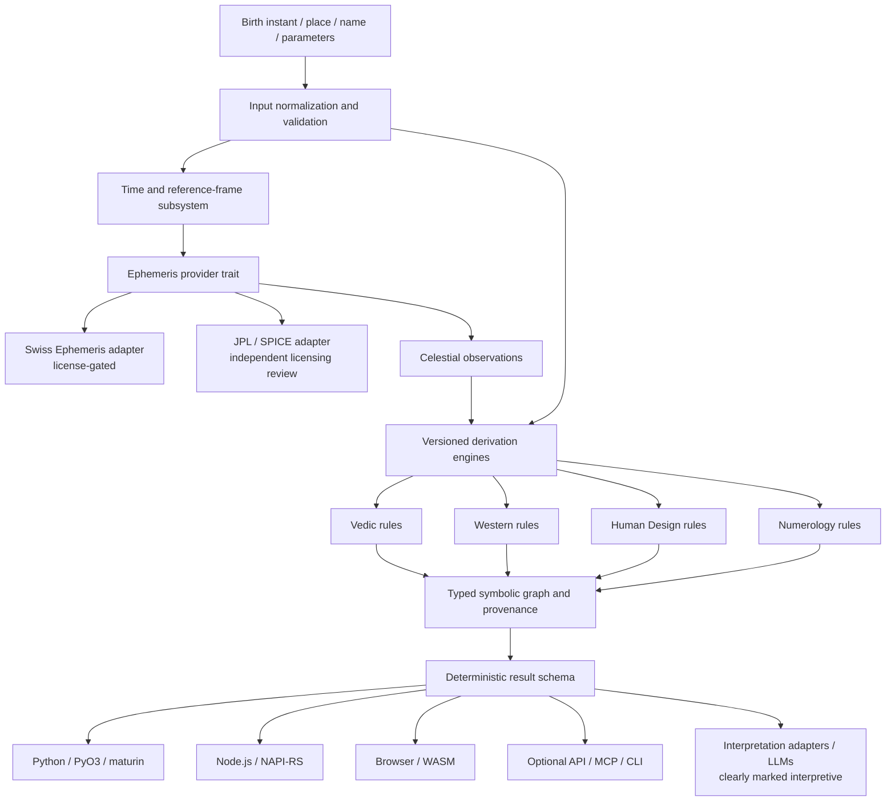
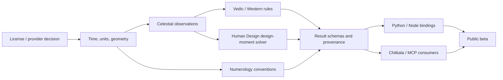

# 🌌 ESHANA — Project Vision & Master Plan

> **ESHANA** — **Extensible Symbolic Hub for Astronomy, Numerology & Archetypes**  
> *From celestial positions to connected meaning.*  
> **A Rust-first, interoperable computational foundation for celestial, temporal, numerical, and symbolic knowledge.**

## 0. Executive decision record

| Topic | Proposed decision | Rationale / caveat |
|---|---|---|
| Product name | **ESHANA** | Inspired by Sanskrit **eṣaṇā** (एषणा): seeking, quest, desire. Different from **Īśāna** (ईशान), a name of Śiva. |
| Official backronym | **Extensible Symbolic Hub for Astronomy, Numerology & Archetypes** | Balanced scope across mathematical and interpretive systems. |
| Technical long form | **Extensible Symbolic Hub for Astronomical and Numerical Analysis** | Useful for SDK / engineering-facing documentation. |
| Tagline | **From celestial positions to connected meaning.** | Emphasizes traceable transformation of measurements into representations. |
| Category | **Symbolic computation infrastructure** | Not merely an astrology app or prediction service. |
| Primary language | **Rust**, with Python, JS/Node, and optional WASM adapters | Shared deterministic computational core, language-agnostic transport. |
| Packaging | `eshana` (Rust and Python), `@neo-pragnya/eshana` (npm; provisional) | Exact registration must be checked before release. |
| License | Prefer permissive core **only where dependencies allow** | Swiss Ephemeris offers AGPL/commercial terms; isolate provider and review legal obligations. |
| Initial audience | Engineers building astrological tools, symbolic-research products, AI agents, and knowledge platforms | A composable SDK before full end-user UI. |
| Product doctrine | **Compute → Derive → Interpret**, with explicit provenance | Prevent empirical calculation from being mistaken for scientific validation of symbolic interpretation. |

**Naming caveat:** ESHANA is a brand transliteration inspired by *eṣaṇā*, not a literal acronym from Sanskrit. There are existing commercial users of “Eshana,” including software-related uses. Conduct trademark and naming clearance before publication. PyPI returned no public project at the exact `eshana` URL when checked November 20, 2026; npm and crates.io exact registration remained unverified. Do **not** treat any name as reserved.

---

# 1. Vision, mission and thesis

## 1.1 Vision

**Make time, space, numerical structure, and symbolic traditions computable through one precise, transparent, extensible foundation.**

ESHANA is a **knowledge-seeking engine**. It should accept grounded inputs—an instant in time, a location, celestial ephemerides, a name, or a set of numerical parameters—and produce deterministic measurements, rule-governed classifications, relationships, and optional interpretations, each with its own provenance.

The goal is **not** to assert that destiny is numerically predetermined. It is to enable faithful implementations and comparative exploration of traditions while accurately distinguishing calculated quantities from interpretive assertions.

## 1.2 Mission

Build the open, modular infrastructure required for diverse developers to:

1. **Compute** reproducible astronomical positions and geometric relationships.
2. **Translate** those into tradition-specific chart and symbolic systems.
3. **Connect** entities, timing cycles, rules, correspondences and knowledge graphs.
4. **Explain** what was computed, what rules were applied, and where interpretations begin.
5. **Embed** the same engine in Rust, Python, Node, browsers, local applications, AI agents, and services.

## 1.3 Core value proposition

Today, integrators often duplicate date conversion, ephemeris calls, zodiac calculations, parsing, chart serialization, and domain-specific rules. ESHANA should consolidate these into a **typed, versioned, testable API** without merging traditions into an incoherent universal theory.

**North-star promise:** *One input, many explicit lenses; one calculation history, many downstream products.*

## 1.4 What ESHANA is not

- Not a single astrology system, horoscope generator, psychic oracle, or trading signal service.
- Not a claim that astrology, numerology, Human Design or related frameworks have validated predictive power.
- Not an LLM that fabricates calculations: numerical work belongs in deterministic code; language models can summarize **attributed** outputs.
- Not a compulsory cloud service: local-first, embedded execution should be supported.

---

# 2. Naming: exhaustive *framework* for acronym exploration

No finite shortlist can enumerate literally every coherent English expansion of six letters; there are effectively unbounded combinations. This chapter provides **36 edited, grammatically plausible combinations**, six clear naming directions, and a wordbank for ongoing ideation. Articles and linking words such as “for,” “and,” and “&” do not count toward the letters.

## 2.1 Recommended candidates (prioritized)

| Rank | Full expansion | Orientation | Score / 10 |
|---:|---|---|---:|
| 1 | **Extensible Symbolic Hub for Astronomy, Numerology & Archetypes** | All-purpose brand | **9.5** |
| 2 | **Extensible Symbolic Hub for Astronomical and Numerical Analysis** | Core engine / developer SDK | **9.2** |
| 3 | **Extensible Semantic Hub for Astronomy, Numerology & Archetypes** | Knowledge graph / ontology | **9.0** |
| 4 | **Extensible Symbolic Hub for Astrological and Numerical Applications** | Product ecosystem | **8.9** |
| 5 | **Explainable Symbolic Hub for Astronomy, Numerology & Archetypes** | Provenance / research | **8.8** |
| 6 | **Extensible Systems for Human, Astronomical & Numerical Analysis** | Human-centered services | **8.5** |

*Scores are editorial naming judgments, not objective or numerical validation of brand performance.*

## 2.2 All 36 curated acronym variants

### A. Universal platform and knowledge foundation

1. **E**xtensible **S**ymbolic **H**ub for **A**stronomy, **N**umerology & **A**rchetypes.
2. **E**xtensible **S**emantic **H**ub for **A**stronomy, **N**umerology & **A**rchetypes.
3. **E**xploratory **S**ymbolic **H**ub for **A**stronomy, **N**umerology & **A**rchetypes.
4. **E**xplainable **S**ymbolic **H**ub for **A**stronomy, **N**umerology & **A**rchetypes.
5. **E**xtensible **S**ymbolic **H**ub for **A**stronomy, **N**umerology & **A**gents.
6. **E**xtensible **S**emantic **H**ub for **A**stronomy, **N**umerology & **A**gents.

### B. Scientific and computational emphasis

7. **E**xtensible **S**ymbolic **H**ub for **A**stronomical and **N**umerical **A**nalysis.
8. **E**xtensible **S**emantic **H**ub for **A**stronomical and **N**umerical **A**nalysis.
9. **E**xplainable **S**ymbolic **H**ub for **A**stronomical and **N**umerical **A**nalysis.
10. **E**xtensible **S**imulation **H**ub for **A**stronomical and **N**umerical **A**nalysis.
11. **E**xtensible **S**ymbolic **H**ub for **A**stronomical and **N**umerological **A**nalytics.
12. **E**xploratory **S**emantic **H**ub for **A**stronomical and **N**umerical **A**nalysis.

### C. Astrology and tradition orientation

13. **E**xtensible **S**ymbolic **H**ub for **A**strology, **N**umerology & **A**rchetypes.
14. **E**xplainable **S**ymbolic **H**ub for **A**strology, **N**umerology & **A**rchetypes.
15. **E**phemeris-backed **S**ymbolic **H**ub for **A**strology, **N**umerology & **A**rchetypes.
16. **E**phemeris-driven **S**ymbolic **H**ub for **A**strology, **N**umerology & **A**rchetypes.
17. **E**xtensible **S**emantic **H**ub for **A**strological and **N**umerological **A**pplications.
18. **E**xtensible **S**ymbolic **H**ub for **A**strological and **N**umerological **A**pplications.

### D. Human-centered interpretation

19. **E**xtensible **S**ystems for **H**uman, **A**stronomical & **N**umerical **A**nalysis.
20. **E**xtensible **S**ystem for **H**uman, **A**strological & **N**umerological **A**nalysis.
21. **E**xplainable **S**ystem for **H**uman, **A**strological & **N**umerical **A**nalysis.
22. **E**xtensible **S**chema for **H**uman, **A**stronomical & **N**umerical **A**ttributes.
23. **E**xtensible **S**chema for **H**uman, **A**strological & **N**umerical **A**pplications.
24. **E**xploratory **S**ystem for **H**uman, **A**rchetypal & **N**umerical **A**nalysis.

### E. AI / ontologies / graph engines

25. **E**xtensible **S**emantic **H**ub for **A**stronomy, **N**umerology & **A**lgorithms.
26. **E**xtensible **S**ymbolic **H**ub for **A**stronomy, **N**umerology & **A**lgorithms.
27. **E**xplainable **S**emantic **H**ub for **A**strological & **N**umerical **A**nalysis.
28. **E**xplainable **S**ymbolic **H**ub for **A**rchetypal & **N**umerical **A**nalysis.
29. **E**xtensible **S**ymbolic **H**ub for **A**strology, **N**umerology & **A**gents.
30. **E**xtensible **S**emantic **H**ub for **A**stronomical & **N**umerical **A**pplications.

### F. Platform infrastructure / interoperability

31. **E**xtensible **S**tandards **H**ub for **A**stronomical & **N**umerical **A**pplications.
32. **E**xtensible **S**chema **H**ub for **A**stronomical & **N**umerical **A**nalysis.
33. **E**xtensible **S**patial **H**ub for **A**stronomical & **N**umerical **A**nalysis.
34. **E**xtensible **S**patiotemporal **H**ub for **A**stronomy, **N**umerology & **A**rchetypes.
35. **E**xplainable **S**ystems **H**ub for **A**strological & **N**umerical **A**pplications.
36. **E**xtensible **S**ymbolic **H**ub for **A**stronomy, **N**umerics & **A**rchetypes.

### Acronym-builder vocabulary

| Letter | Recommended vocabulary | Avoid / caution |
|---|---|---|
| E | Extensible, Explainable, Exploratory, Ephemeris-backed, Ephemeris-driven | “Empirical” if implying empirical validity for symbolic interpretations |
| S | Symbolic, Semantic, Spatiotemporal, System, Schema, Standards | “Scientific astrology” framing |
| H | Hub, Harmonization, Hypothesis, Human, Hierarchy | “Holistic” where scientifically vague |
| A₁ | Astronomy, Astronomical, Astrology, Astrological, Archetypal | “Astral” is evocative but less precise |
| N | Numerology, Numerical, Numerics, Numerological, Networks | Numerology is a tradition; numerical analysis is mathematics; do not conflate |
| A₂ | Archetypes, Analysis, Analytics, Applications, Agents, Algorithms, Attributes | “Accuracy” for interpretation without testable criteria |

**Decision rule:** Select *one canonical brand expansion* and allow other phrases to describe capabilities; don't change the acronym between package manifests, docs, marketing pages and API references.

## 2.3 Decision criteria

| Criterion | Weight | Evaluation question |
|---|---:|---|
| Breadth / longevity | 25% | Can it encompass Human Design and future symbolic systems? |
| Technical accuracy | 20% | Does it truthfully describe what the SDK computes? |
| Memorable rhythm | 15% | Is it easy to say, write and recall? |
| Architectural fit | 15% | Does it sound like reusable infrastructure? |
| Domain neutrality | 15% | Does it avoid giving one interpretation framework privileged truth? |
| Product ecosystem fit | 10% | Does it coexist with Neo-Pragnya and Chitkala? |

**Final proposed choice:** #1 as official; #2 as a descriptive technical subtitle rather than a second official expansion.

---

# 3. Users, jobs to be done and product ecosystem

| Persona / consumer | Job to be done | ESHANA capability |
|---|---|---|
| Astrology software developer | Compute exact and reproducible Vedic/Western charts | Positions, frames, houses, divisional charts, aspects, dashas |
| Human Design product | Construct BodyGraph from birth data | Birth/design instants, gates, lines, channels, profiles |
| Numerology application | Apply named numerological schools | Character mappings, derivations, life-cycle tables |
| Compatibility / dating app | Compare chart and number-derived attributes | Typed compatibility feature sets and transparent rule packs |
| Knowledge platform / Chitkala | Browse causes, correspondences, concepts and interpretations | Entity graph, crosswalks, provenance, visual exports |
| AI assistant / agent | Retrieve facts and explain calculations | Stable JSON/JSON Schema, structured tools, citations to rule provenance |
| Trading research environment | Explore historical timing hypotheses | Timestamp-safe features, look-ahead-bias prevention, backtesting interfaces |
| Academic / comparative researcher | Contrast traditions and reproducibility | Model versioning, assumption audit, multiple calculation methods |

**Trading caution:** Astrological/numerological trading strategies should be labeled unvalidated hypotheses, with out-of-sample tests, controls for selection bias and no claims of forecasting edge without evidence.

### Business model options

1. **Open core**: permissively licensed mathematical and infrastructure layers where legally feasible.
2. **Domain rule packs**: published open packs for straightforward public-domain mappings; separately licensed content where required.
3. **Hosted API**: operational convenience, SLA, caching, batch compute, tenant controls; not mandatory for use.
4. **Developer tooling**: chart explorer, diff comparator, rule editor and validation dashboard.
5. **Enterprise add-ons**: audit trails, fine-grained access, private deployments, connectors and integration support.

---

# 4. Scope and precise domain definitions

## 4.1 Three-layer epistemic model

| Layer | Examples | Validation / epistemic status |
|---|---|---|
| **Calculated** | UTC instant, Julian day, ecliptic longitude, latitude, speed, angular separation | Mathematically verifiable against reference ephemerides and definitions |
| **Derived by a named system** | Nakshatra, house placement, aspect, divisional sign, HD gate, numerology result | Deterministic under explicit tradition/method/rule version; traditions can disagree |
| **Interpretive** | Character profile, symbolism, relational narrative, transit meaning | Attribution required; interpretations are beliefs or hypotheses, not established causal facts |

### Critical invariants

- Never erase **tropical vs sidereal** distinction.
- Expose **ayanāṃśa** and its model/version when sidereal is requested.
- Differentiate **mean vs true lunar node**; don't silently substitute.
- Expose house system (`whole_sign`, `placidus`, `equal`, etc.) and latitudinal limitations.
- Distinguish **geocentric vs topocentric**, true/apparent and coordinate frames.
- Preserve seconds or finer timestamp precision and exact time zone assumptions; don't infer unknown birth time.
- Preserve **all coordinates as typed units** with canonical normalization (degrees, radians, arcseconds as indicated).
- Bundle deterministic rules and output provenance; never silently overwrite an interpretive model.

## 4.2 Astronomical and chronological kernel

**Inputs:** local or UTC datetime, civil calendar, IANA time zone, latitude/longitude/altitude, provider selection, output coordinate frame, sidereal configuration, and requested bodies.

**Outputs:** UTC/TT/JD representations as appropriate, longitudes/latitudes, distance, longitude speed, retrograde/station state, declination/right ascension where supported, rising/setting where supported, house cusps, angles (ASC/MC), eclipses/phase-related events as future extensions.

**Required bodies:** Sun, Moon, Mercury, Venus, Mars, Jupiter, Saturn, Uranus, Neptune, Pluto, mean and true lunar nodes (and optionally south node derived consistently), Chiron and asteroids as optional extensions; document body/provider availability.

**Providers:** abstract an `EphemerisProvider` trait. Candidate implementations include Swiss Ephemeris (**dual AGPL/professional commercial license**, require license review) and independently licensed NASA/JPL SPICE-based calculations. Do not assume output agreement without aligning time scales, frames and flags.

## 4.3 Vedic astrology modules

- Rāśi / D1 chart; Lahiri and other named ayanāṃśa configurations.
- Nakshatra, pada, sign, absolute and within-sign longitude, exact boundary logic.
- Whole-sign and configurable bhāva systems; define differences between rāśi and bhāva explicitly.
- Major divisional charts (D9, D10, D7, D12, D30, D60) after unit-tested D1/D9; school-specific mapping rules must be versioned.
- Graha dṛṣṭi / special aspects, rāśi dṛṣṭi, dignities, relationships and strength calculations via separate rulesets.
- Vimśottarī daśā, subperiods, configurable year convention and starting balance.
- Transits, gochara, retrograde windows, combustion and other rule-based events.
- Additional traditions (Jaimini, Tajika, etc.) only as explicitly named adapters, never silently blended.

## 4.4 Western astrology modules

- Tropical zodiac, optional sidereal Western variants.
- House systems: whole sign/equal first, Placidus/others with documented circumpolar edge handling.
- Planets, chart points, house positions, retrogrades, sign ingress and transits.
- Ptolemaic aspects with user-selected orbs and applying/separating status.
- Natal, synastry, composite, progressions, solar/lunar returns as staged additions.
- Dignity and interpretive traditions separate from measurements.

## 4.5 Human Design calculation module

- Calculate **Personality/birth instant** and **Design instant** when the Sun had traversed precisely **88° of ecliptic longitude** before the birth position—not a fixed 88 days earlier.
- Encode a versioned gate/line wheel and mapping tables, along with activations and centers, channels, definition, type, profile and authority according to explicitly cited rule editions.
- Provide transparent treatment of boundary positions, node convention, rounding, and time-zone effects.
- Distinguish public-domain mathematical operations from protected charts, nomenclature, copyrighted expression, trademarks or proprietary mapping materials; consult counsel before commercial use.

## 4.6 Numerology module

- Pluggable `NumerologySystem` with explicit Latin transliteration, locale, whitespace/diacritic normalization and tokenization policies.
- Pythagorean, Chaldean and other methods **as distinct schemas**, not a merged result.
- Name totals, compound numbers, reduction rules, master-number handling, life path and personal cycle computations.
- Inputs, letter-by-letter breakdown and chosen convention included in output.

## 4.7 Symbolic graphs and comparative ontology

- Nodes: entity, position, event, rule, tradition, period, concept, archetype, interpretation, source.
- Edges: `calculated_from`, `classified_as`, `uses_rule`, `associated_with`, `contrasts_with`, `derived_from`, `interpreted_as`, `cites`.
- Each rule and edge carries **tradition_id, source, method_version, valid domain and epistemic tag**.
- Distinguish **causal**, **correlational**, **traditional symbolic correspondence**, and **hypothesized** relationships; do not put them in a single unlabeled relationship field.
- Visualization export: JSON graph, GraphML, Mermaid, SVG/draw.io via adapters; Chitkala can render interactive 2D/3D representations separately.

---

# 5. Architecture



**Mermaid note:** This diagram is a logical flow; actual graph conversion and rendering should be separate adapters. The core does not need an external graph database.

## 5.1 Crate workspace (proposed)

```text
eshana/
├── Cargo.toml                       # Workspace
├── LICENSES/                        # All dependency and ephemeris notices
├── crates/
│   ├── eshana-core/                 # Units, errors, types, provenance
│   ├── eshana-time/                 # IANA tzdb handling, timescales, calendars
│   ├── eshana-ephemeris/            # Provider trait + reference frames
│   ├── eshana-ephemeris-swiss/      # Optional, license-dependent adapter
│   ├── eshana-ephemeris-spice/      # Optional JPL/SPICE-based adapter
│   ├── eshana-astro/                # Coordinate geometry, houses, aspects
│   ├── eshana-vedic/                # Vedic rule packs
│   ├── eshana-western/              # Western rule packs
│   ├── eshana-human-design/         # Human Design calculations
│   ├── eshana-numerology/           # Number systems and names
│   ├── eshana-ontology/             # Symbolic graph types
│   ├── eshana-engine/               # Composition / orchestration facade
│   ├── eshana-cli/                  # CLI
│   ├── eshana-python/               # PyO3 bindings
│   ├── eshana-node/                 # NAPI-RS bindings
│   └── eshana-wasm/                 # Optional WebAssembly bindings
├── rulesets/                        # Versioned published rule data
├── schemas/                         # JSON Schema, examples, migration specs
├── benchmarks/                      # Golden datasets and benchmarking
├── examples/                        # Natal, comparative, HD, numerology
├── docs/                            # API, ADRs, licensing, provenance
└── .github/workflows/               # Build, test, lint, security, releases
```

**Pragmatic launch:** Start with 4–5 actual crates (`core`, `time`, `ephemeris`, `engine`, `python`), and keep traditions in modules until APIs stabilize. Avoid premature crate fragmentation.

## 5.2 Key traits and typed models (illustrative design, not implemented)

```rust
pub struct BirthContext {
    pub instant_utc: String,      // production: strongly typed instant
    pub latitude_deg: f64,
    pub longitude_deg: f64,
    pub altitude_m: Option<f64>,
    pub original_tz: Option<String>,
    pub birth_time_quality: TimeQuality,
}

pub struct CalculationConfig {
    pub ephemeris_provider: String,
    pub frame: CoordinateFrame,
    pub zodiac: ZodiacSystem,
    pub house_system: HouseSystem,
    pub node_model: NodeModel,
    pub ruleset_versions: Vec<String>,
}

pub struct Provenance {
    pub engine_version: String,
    pub provider: String,
    pub provider_data_version: Option<String>,
    pub tzdb_version: String,
    pub rulesets: Vec<String>,
    pub assumptions: Vec<String>,
}

pub trait EphemerisProvider: Send + Sync {
    fn positions(&self, query: &EphemerisQuery)
        -> Result<Vec<BodyPosition>, EphemerisError>;
}
```

### Example result envelope (conceptual JSON)

```json
{
  "schema_version": "0.1.0",
  "kind": "computed_chart",
  "input": {"instant_utc": "2000-01-01T12:00:00Z", "latitude_deg": 0.0, "longitude_deg": 0.0},
  "calculation": {
    "provider": "example-provider",
    "frame": "geocentric_ecliptic_of_date",
    "zodiac": "tropical",
    "houses": "whole_sign",
    "node_model": "mean",
    "ruleset_version": "western-0.1"
  },
  "positions": [],
  "derived_attributes": [],
  "interpretations": [],
  "provenance": {"ephemeris_version": "example", "tzdb_version": "example", "assumptions": []}
}
```

All empty arrays and provider names here are placeholders, not calculated celestial data.

## 5.3 Python and TypeScript facade (proposed)

```python
from eshana import Context, ChartEngine

ctx = Context.from_local_birth(
    date="1992-05-28",
    time="20:05:00",
    timezone="Asia/Kolkata",
    latitude=17.385,
    longitude=78.487,
)

engine = ChartEngine(provider="configured-provider")
vedic = engine.vedic_chart(ctx, ayanamsha="lahiri", divisions=[1, 9])
western = engine.western_chart(ctx, zodiac="tropical", houses="whole_sign")
assert vedic.provenance and western.provenance
```

```ts
import { ChartEngine } from '@neo-pragnya/eshana';
const engine = new ChartEngine({provider: 'configured-provider'});
const chart = await engine.westernChart({
  instantUtc: '2000-01-01T12:00:00Z', latitude: 0, longitude: 0
});
console.log(chart.provenance);
```

Interfaces are forward-looking design sketches. Do not advertise them as currently installed or implemented.

## 5.4 AI, MCP and Chitkala integrations

- Use **structured tools** such as `compute_positions`, `create_vedic_chart`, `compare_charts`, `compute_human_design`, `compute_numerology`, `explain_derivation`.
- Tool outputs have **schemas, known defaults, explicit uncertainty, cited rules**, and clear separation of facts, derivations and interpretations.
- Chitkala consumes ESHANA entities into its graph—without conflating symbolic associations with physical causality.
- A separate AI interpretation service can read derived outputs and source text. It should *not* recompute celestial positions in a prompt.
- Support a local process/embedded library first; optional service APIs (REST/gRPC/MCP) when there is demand.

---

# 6. Accuracy, test strategy and benchmarks

## 6.1 Golden dataset design

Maintain reference fixtures across:

- Historical and modern dates; BCE/CE conventions, Julian/Gregorian cutovers and leap days.
- DST transitions, ambiguous/nonexistent local times, changed time-zone law, missing time zone data.
- Equator, high latitudes, polar circles, near-house-boundary places; no silent Placidus extrapolation.
- Tropical/sidereal boundary crossings; ayanāṃśa model variations.
- Mean/true nodes, speed-zero stations, longitude wraparound, retrograde transitions.
- Exact aspect/orb boundaries, sub-arc-minute HD gate boundaries, dashā boundary instants.
- Pythagorean/Chaldean examples including transliteration edge cases.
- Randomized properties: angle normalization, roundtrip conversions, monotonic Julian times where defined.

## 6.2 Test pyramid

| Test | Aim | Release gate |
|---|---|---|
| Unit | Correct arithmetic, conventions, boundary rules | Mandatory |
| Property / fuzz | No panics, invariant preservation | Mandatory for input and time modules |
| Golden / differential | Match independently calculated reference cases within documented tolerances | Mandatory for astrometry and chart arithmetic |
| Tradition conformance | Match published test vectors / verified reference charts under same conventions | Mandatory per traditions module |
| Cross-language parity | Rust, Python, Node return semantically identical JSON | Mandatory for bindings |
| License and supply chain | No prohibited license combination, audit vulnerabilities | Mandatory |
| Performance | Compare warmed/cold, single/batch workloads and memory | Track from first beta; don't promise unmeasured multipliers |

**Suggested initial SLO targets (aspirational, to calibrate after choosing provider):** stable serialization schema; 100% golden fixtures passing; no undocumented implicit defaults; no cross-binding numerical discrepancies beyond documented floating-point tolerance; median batch throughput baseline and regression threshold recorded on a pinned machine.

## 6.3 Versioning contract

- `schema_version`: output contract version.
- `engine_version`: core binary version.
- `provider_version` and **ephemeris file identity**: reproducibility.
- `tzdb_version`: historical time conversion reproducibility.
- `rule_version` and `tradition_id`: derivation reproducibility.
- `interpretation_model_version`: separate; never implied by result contract.
- Semantic versioning for stable packages; reproducibility lockfile manifests for complex chart calculations.

---

# 7. Security, privacy, ethics and intellectual property

1. **Birth information is personal data:** collect only necessary fields, compute locally when possible, minimize logging and default to no retention; encrypt any persisted records and provide deletion workflows.
2. **Birth-time uncertainty is first-class:** allow approximate, unknown and interval representations; do not invent an exact instant.
3. **Interpretive outputs require epistemic labels:** `calculated`, `tradition_rule`, `speculative_interpretation`, `research_hypothesis`.
4. **No deterministic claims about people:** do not present compatibility or personality classifications as assessments of real-world suitability, health, or employability.
5. **Financial safety:** trading modules should contain data features and backtesting infrastructure, not promises of investment returns; guard against leakage, p-hacking and overfitting.
6. **Provider license audit:** Swiss Ephemeris AGPL/commercial terms deserve a formal engineering/legal decision before distributing linked binaries. JPL/NAIF alternatives require independent assessment of toolkit and data distribution obligations.
7. **Human Design/IP:** verify rights in branded terminology, tables, visual layouts and third-party text. Prefer original documentation and independently implemented mathematics.
8. **Third-party rule citations:** each rule pack should document sources, edition/version and transformation.
9. **Software supply chain:** cargo audit, secret scanning, signed releases, release provenance, SBOM and pinning.

---

# 8. Development roadmap (solo-engineer-friendly, indicative)

The following is a **16-week initial release path** with stretch work deferred. Exact delivery depends on selected ephemeris provider, license constraints and conformance data availability.

| Phase | Weeks | Deliverables | Exit criterion |
|---|---|---|---|
| **0. Charter / licensing** | 1–2 | Name clearance, product ADRs, licensing matrix, versioned schema outline, public test vector list | Provider path and licensing decision documented |
| **1. Rust core** | 3–4 | Time/tzdb, units, typed input, ephemeris trait, reference conversions, error and provenance model | Golden timezone/angle tests pass |
| **2. First charts** | 5–7 | Planetary positions, zodiac config, nodes, basic houses; Vedic D1/D9 + Western natal/aspects | Differential fixtures pass across documented cases |
| **3. Language SDKs** | 8–9 | Python wheels, Node bindings, JSON schema, example app, CLI, CI matrix | Parity tests and install smoke tests pass |
| **4. Additional systems** | 10–12 | Numerology rule packs; initial HD birth/design solar-arc solver; rule provenance | Boundary fixtures and reference comparisons pass |
| **5. 0.1 release** | 13–16 | Stable beta API, docs, cookbook, sample chart explorer, packaged artifacts, security/license notices | Release checklist, benchmark baseline and public docs complete |

## 8.1 MVP scope (must-have)

- [ ] Inputs: precise time, location, timezone, uncertainty representation.
- [ ] Provider abstraction + one legally compliant accurate ephemeris backend.
- [ ] Solar/lunar/planetary positions and lunar nodes with configuration.
- [ ] Tropical and sidereal zodiac; configurable ayanāṃśa.
- [ ] Vedic D1/Nakshatra/pada + D9; Western natal and standard aspects.
- [ ] Pythagorean and Chaldean name-number calculations.
- [ ] Provenance, source rules, raw/derived/interpretive segregation.
- [ ] PyPI + crates.io packaging (subject to name availability) with basic docs and tests.
- [ ] Demonstration: same birth inputs shown as Vedic and Western charts.

## 8.2 Beta expansions (should-have)

- [ ] Vimśottarī daśā, selected divisional charts, advanced houses.
- [ ] Human Design personal/design activations + BodyGraph mappings if legally validated.
- [ ] Node graph JSON, cross-tradition query model, provenance inspection.
- [ ] Node.js bindings and browser WASM for local chart display.
- [ ] Event search: transits, ingresses, stations, returns.

## 8.3 Later extensions (could-have)

- Synastry and comparative charts, compositing, progressions, Jaimini and further Jyotisha traditions.
- I Ching adapters, selected calendars and non-astrological cyclic models.
- Rule authoring/validation DSL, confidence and uncertainty explorer.
- Graph visualizer for Chitkala and standardized chart export SVG/PDF.
- MCP/agent templates, batch compute, hosted API and advanced backtesting toolkit.

### MVP exclusions

- No unverified numerical prediction of life outcomes, romantic success, medical conditions, or trading profitability.
- No requirement for a hosted LLM or external account to compute charts.
- No universal unversioned `destiny_score` or `compatibility_score`.
- No broad marketplace of esoteric traditions before core conformance.

---

# 9. Workstreams, ownership and dependency order



**Single-owner program lanes:**

| Lane | Concrete outputs |
|---|---|
| Architecture | ADRs, schema definitions, cross-language interface design |
| Astronomy | backend adapter, timestamps, coordinates, validated planetary positions |
| Tradition rules | unit-tested Vedic/Western/numerology/HD models and source citations |
| Developer experience | CLI, bindings, examples, API reference and getting-started guide |
| Quality | golden datasets, fuzz tests, performance regression harness |
| Governance | license compliance, package name clearance, privacy notices |
| Integrations | Chitkala graph export, agent tools, example SDK consumer |

### Critical dependencies

1. **Ephemeris legal/technical decision** precedes shipping binaries.
2. **Time conversion and coordinate contracts** precede all charts.
3. **Tradition rules** require stable measured-position interfaces.
4. **Cross-language bindings** should expose the same versioned facade, not reimplement rules.
5. **AI interpretation** starts after provenance and deterministic schemas work.

---

# 10. Product demos that prove utility

## Demo A — Dual-tradition natal chart

Input one birth context → Vedic sidereal D1/D9 and Western tropical natal. Every derived value links to rule settings, longitude and method version. Highlight disagreements as **configuration differences**, not software defects.

## Demo B — A transparent numerology analyzer

Input a name and birth date → letter-to-number table, compound total, reduced result, selected alphabet mapping, separate Chaldean/Pythagorean breakdown, transformation trace.

## Demo C — Human Design calculation trace

Birth Sun longitude → numerical root-solve of prior 88° solar arc → design instant → second set of body positions → gate/line mappings → assembled BodyGraph attributes. Surface the boundary/tolerance and chosen wheel edition.

## Demo D — Chitkala graph explorer

Create graph of `CelestialPosition -> Nakshatra -> Rule -> Interpretation`, with color-coded edge semantics, notes and human-reviewed content. Keep astronomical and interpretive edges distinguishable.

## Demo E — Method comparison

Same inputs under `mean_node` vs `true_node`, different ayanāṃśa and house systems, with a JSON diff showing which placements changed and why.

---

# 11. Success metrics

**Technical product metrics (measured):**

- Accuracy: reference fixture pass rate and max/median angular error (within chosen provider's capabilities).
- Reliability: no-panic/fuzz results, deterministic replay success, timezone edge-case pass rate.
- Distribution: install success on Linux/macOS/Windows; binary coverage; package sizes.
- Speed: cold-start latency, single-chart latency, throughput at batch sizes 100/1,000, CPU and memory profiles.
- Developer usability: minutes-to-first-valid-chart; sample run completion; docs quality checks.
- Governance: percentage of derived outputs with ruleset/provenance; all third-party license notices present.

**Adoption indicators:** unique dependent open-source projects, issue resolution time, reproducible examples, external contributors and working partner integrations. Do not make adoption claims before release.

**North-star metric:** percentage of valid requests that return **correctly configured, reproducible, attributed outputs** without custom downstream recomputation.

---

# 12. Open questions and architectural decisions

| ADR | Decision needed | Initial recommendation |
|---|---|---|
| ADR-001 | Ephemeris provider and licensing | Abstract provider; establish legal path before release |
| ADR-002 | Time representation | Strongly typed UTC/TT conversions + named IANA zone + tzdb version |
| ADR-003 | House system handling | Explicit enum; clear errors for unsupported latitudes |
| ADR-004 | Rule packaging | Versioned data-driven rule packs, code for nontrivial algorithms |
| ADR-005 | Ontology persistence | In-memory graph + JSON exports first; DB connectors optional |
| ADR-006 | API shape | Typed Rust facade + canonical JSON schema; bindings thin |
| ADR-007 | Naming + scope | ESHANA product name, one canonical backronym; registry/trademark clearance |
| ADR-008 | Licensing model | Permissive own core only where third-party dependencies allow |
| ADR-009 | HD nomenclature and mapping rights | Review before shipping public feature |
| ADR-010 | Privacy and data retention | Local-first, default zero server retention |

---

# 13. Recommended first engineering sprint

**Sprint 0 — establish proof of correctness, not a UI:**

1. Create `neo-pragnya/eshana` workspace after checking GitHub repository and brand constraints.
2. Draft `VISION.md`, `ARCHITECTURE.md`, `LICENSE-DECISIONS.md`, `CALCULATION-CONVENTIONS.md`.
3. Select and document the ephemeris backend and its distribution rights.
4. Implement `BirthContext`, `Instant`, `Angle`, `Coordinates`, `CalculationConfig`, `Provenance`.
5. Implement a provider interface and a CLI that returns one test vector's planetary longitudes.
6. Implement cross-frame angle-normalization and timezone/DST tests.
7. Add 10–20 independently validated golden cases spanning tropical, sidereal, node and boundary conditions.
8. Set up `cargo fmt`, `clippy`, `test`, unit + property tests, CI, dependency/license audit.
9. Create one real end-to-end example showing the **same astronomical results** converted into two configured zodiac systems.
10. Only after this, expose the first Python binding.

**Definition of done:** a deterministic chart computation can be replayed with complete provider/configuration provenance, and test vectors agree with documented baselines within explicit tolerances.

---

# 14. Messaging / brand system

**One-liner:** ESHANA is the Rust-first computation layer for celestial coordinates, symbolic frameworks, and traceable derived knowledge.

**Tagline candidates:**

- **From celestial positions to connected meaning.** *(Recommended)*
- **Compute precisely. Interpret transparently.** *(Developer-focused)*
- **Explore the patterns of existence.** *(Philosophical)*
- **One foundation. Many traditions.** *(Platform-focused)*
- **Time. Space. Symbols. Understanding.** *(Minimal)*
- **Where cosmic knowledge becomes computable.** *(Evocative; avoid implying all interpretations are objective facts)*

**Brand voice:** precise, curious, philosophically literate, non-dogmatic, open, auditable, technically rigorous.

**Conceptual visual direction:** dark cosmic field with precise orbital arcs, a central reference point, layered concentric coordinate frames and small graph nodes representing symbolic relationships; avoid claiming to visually encode physical causal effects that have not been shown.

**Suggested logo motif:** a minimal center-dot (*bindu*) within 2–3 intersecting orbital/graph pathways, with a quiet mathematical rather than horoscope aesthetic.

---

# 15. Verified reference anchors (as of 2026-11-20)

- Sanskrit *eṣaṇā* meaning: Monier-Williams dictionary, University of Hyderabad mirror: https://sanskrit.uohyd.ac.in/SKT/MW/51.html
- Swiss Ephemeris licensing: https://www.astro.com/swisseph/swephinfo_e.htm
- 2026 Swiss Ephemeris professional license contract: https://www.astro.com/swisseph/secont_e_2609.pdf
- NASA/JPL ephemerides: https://ssd.jpl.nasa.gov/ephem.html
- JPL NAIF SPICE: https://naif.jpl.nasa.gov/
- IANA Time Zone Database: https://www.iana.org/time-zones/tz-link
- PyO3: https://pyo3.rs/
- maturin: https://github.com/PyO3/maturin
- NAPI-RS: https://napi.rs/
- Human Design computation example (88° solar arc): https://myhumdesign.com/methodology
- Eshana software brand example: https://www.linkedin.com/company/eshana-software-solutions-llc

The registry, legal and scientific/interpretive distinctions noted above are essential constraints, not post-launch cleanup items.

---

## Closing thesis

> **ESHANA is an engine of inquiry.** It computes what can be computed, identifies the tradition that governs each derivation, exposes how conclusions were reached, and connects those outputs into an extensible knowledge model. Its mathematical capabilities must be precise; its symbolic interpretations must be transparent; and its architecture must be useful across many products without becoming dependent on any one of them.
