<div align="center">

<picture>
  <source media="(prefers-color-scheme: light)" srcset="assets/readme/hero-light.svg" />
  
</picture>

# ESHANA

**E**xtensible **S**patiotemporal **H**ypersystem for **A**stroinformatics, **N**atural Cycles & **A**ssociations

### *From celestial positions to connected meaning.*

A Rust engine for celestial positions, civil time and the traditions built on them (Jyotiṣa, Western astrology,
Human Design and numerology), with an offline **chart studio**, a Python API and a CLI. Every number is computed,
every rule is named, and **no interpretation is ever invented**.

[](https://pypi.org/project/eshana/)
[](https://pypi.org/project/eshana/)
[](crates/eshana-engine)
[](docs/adr/013-local-engine-adapter.md)
[](LICENSE)
[](https://github.com/Neo-Pragnya/ESHANA/actions/workflows/ci.yml)
[](https://neo-pragnya.github.io/ESHANA/)
[](acceptance/README.md)

[**📖 Docs**](https://neo-pragnya.github.io/ESHANA/) ·
[**🖼️ Gallery**](https://neo-pragnya.github.io/ESHANA/gallery/) ·
[**🪐 Live studio**](https://neo-pragnya.github.io/ESHANA/reports/example-studio-app.html) ·
[**🐍 PyPI**](https://pypi.org/project/eshana/) ·
[**📝 Changelog**](CHANGELOG.md) ·
[**🗺️ Roadmap**](docs/next-steps.md)

</div>

> [!NOTE]
> ESHANA makes the rules of astrology, numerology and Human Design **computable and auditable**. It does not claim
> they predict anything, and its `interpretations` field is always empty. Experimental pieces are labelled as such
> in every result.

---

## 📚 Contents

<table>
<tr>
<td valign="top">

**Start here**
- [✨ Why ESHANA?](#-why-eshana)
- [🧭 Three layers, kept apart](#-three-layers-kept-apart)
- [⚡ Quick start](#-quick-start)
- [🪐 ESHANA Studio](#-eshana-studio)
- [📝 A new chart from a form](#-a-new-chart-from-a-form)

</td>
<td valign="top">

**What it does**
- [🔭 What it computes](#-what-it-computes)
- [🪔 Muhūrta, step by step](#-muhūrta-step-by-step)
- [🧪 One engine, every question](#-one-engine-every-question)
- [🐍 Python cookbook](#-python-cookbook)
- [📐 Formulas, written down](#-formulas-written-down)

</td>
<td valign="top">

**Trust and internals**
- [⚙️ How it works](#️-how-it-works)
- [🛡️ Guarantees](#️-guarantees)
- [📏 Accuracy, measured](#-accuracy-measured)
- [📖 Reference](#-reference)
- [🛠️ Development and releases](#️-development-and-releases)
- [❓ FAQ](#-faq) · [🤝 Status](#-status-and-honesty)

</td>
</tr>
</table>

---

## ✨ Why ESHANA?

Astrology software usually mixes three very different things on one screen: astronomy you can verify, rules that
belong to one school, and readings someone wrote. ESHANA pulls them apart so each can be checked on its own terms.

| | 😕 The usual way | 🌟 With ESHANA |
|---|---|---|
| 🕰️ **Birth time** | A local time is quietly turned into UTC; a time that the clocks skipped becomes *something* | IANA zones with historic offsets; a skipped or repeated time is an **error with a code**, never a guess |
| 📐 **Methods** | Ayanāṃśa, houses and daśā variants are buried in settings | Every method has an **id**; an unknown one is refused (`ESH-METHOD`); the choice travels with the result |
| 🧾 **Results** | Numbers without a trail | **Provenance** on every envelope: engine, provider, tz database, rule versions, assumptions and a `config_hash` |
| 🔮 **Meaning** | Readings presented as facts | `interpretations` is **always empty**; rules are labelled `tradition_rule`; research scores are labelled *experimental* |
| 🌍 **Surfaces** | The web app and the API drift apart | One `Engine::execute_json` behind the CLI, Python and the studio (compiled to WebAssembly) |
| 🔒 **Privacy** | Birth data uploaded to a server | Everything runs on your machine; the studio is one offline HTML file |

---

## 🧭 Three layers, kept apart

| Layer | Example | Produced by | In the envelope |
|---|---|---|---|
| 🧮 **Calculated** | ecliptic longitude, speed, Ascendant, sunrise | verifiable code, tested against JPL DE440s and the Swiss Ephemeris | `positions`, `houses` with `epistemic: calculated` |
| 📜 **Derived by a named system** | nakshatra and pada, varga sign, daśā period, muhūrta window, Human Design gate, name number | a versioned **rule pack** with a method id | `derived_attributes` with `epistemic: tradition_rule` |
| 🔮 **Interpretive** | character, meaning, compatibility | **never the engine** | `interpretations: []`, always |

```jsonc
{
  "kind": "chart", "schema_version": "0.4.0",
  "positions": [{ "id": "moon", "longitude_deg": 88.33, "epistemic": "calculated", "sign": { "name": "Mithuna", "dms": "28°19′42″" } }],
  "derived_attributes": [{ "id": "vedic.moon.nakshatra", "epistemic": "tradition_rule", "value": { "name": "Punarvasu", "pada": 3 } }],
  "interpretations": [],
  "calculation": { "ayanamsha": "lahiri", "house_system": "whole_sign", "config_hash": "fnv1a64:…" },
  "provenance": { "engine_version": "0.5.0", "tzdb_version": "2026f", "assumptions": ["house_system not given; whole_sign used", "…"] }
}
```

---

## ⚡ Quick start


```bash
pip install eshana

# 🪐 a full chart studio in one offline HTML file (--live embeds the engine for recomputing in the page)
eshana-report --date 1992-05-28 --time 20:05 --tz Asia/Kolkata --lat 17.385 --lon 78.487 --live -o chart.html

# 📝 or let a form ask for the details: it opens in your browser, writes the chart, and stops
eshana-report new -o charts/
```

```python
from eshana import ChartEngine, Context

ctx = Context.from_local_birth(date="1992-05-28", time="20:05:00", timezone="Asia/Kolkata",
                               latitude=17.385, longitude=78.487)
chart = ChartEngine().vedic_chart(ctx, ayanamsha="lahiri", divisions=[1, 9], dasha=True)

chart.position("moon")["sign"]["name"]           # 'Meena'
chart.attribute("vedic.moon.nakshatra")["name"]  # 'Revati'
chart.provenance["assumptions"]                  # everything that was chosen for you
chart.to_html("chart.html")                      # the studio, from Python
```

> [!TIP]
> Unknown birth time? Leave out `--time`. Positions and signs that hold all day are kept; the Ascendant, houses and
> anything else that needs the hour are listed under **Not computed**, with the engine's reason.

---

## 🪐 ESHANA Studio

`eshana-report` writes **one self-contained HTML file** that works as a multi-page app: no server, no network,
prints cleanly. With `--live` it carries the engine itself, compiled to WebAssembly, so the compare workspace and the
playground recompute offline with exactly the same rules as Python and the CLI.

<table>
<tr>
<td width="33%"><a href="https://neo-pragnya.github.io/ESHANA/reports/reference-ramana.html#/chakra">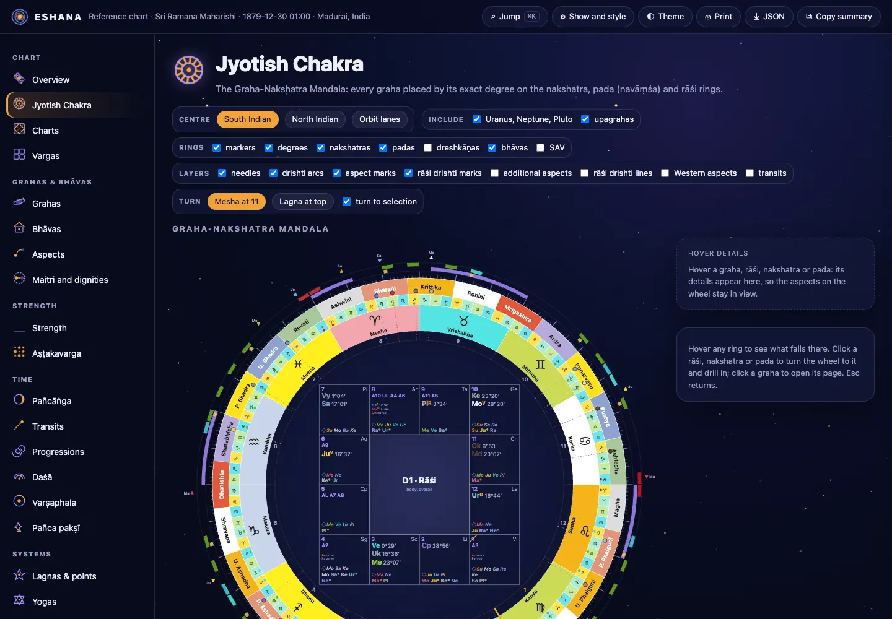</a><br/><b>🌀 Jyotish Chakra</b><br/><sub>Every graha by exact degree on the nakshatra, pada and rāśi rings, with the D1 chart and the Nadi directions in the centre.</sub></td>
<td width="33%"><a href="https://neo-pragnya.github.io/ESHANA/reports/reference-ramana.html#/charts">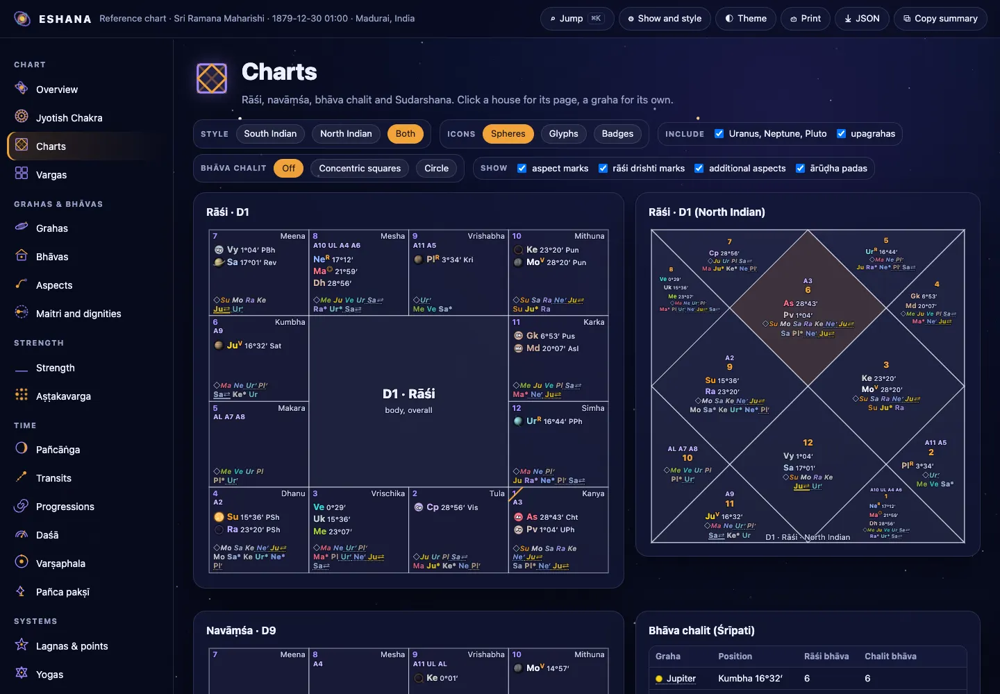</a><br/><b>🔲 South and North Indian charts</b><br/><sub>Grahas bold and first; ārūḍha padas and aspect marks smaller; crowded signs reflow.</sub></td>
<td width="33%"><a href="https://neo-pragnya.github.io/ESHANA/reports/reference-ramana.html#/vargas">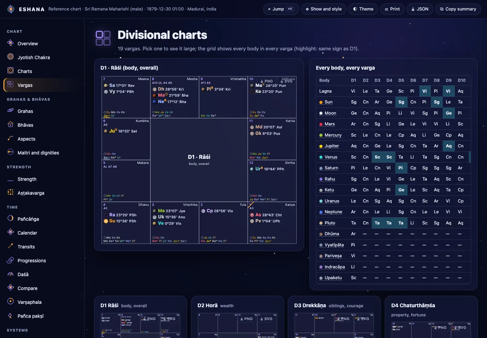</a><br/><b>🧩 Vargas</b><br/><sub>D1 to D60, plus parivṛtti D2/D3, D81, D108 and D144 as named methods.</sub></td>
</tr>
<tr>
<td><a href="https://neo-pragnya.github.io/ESHANA/reports/example-studio-app.html#/calendar">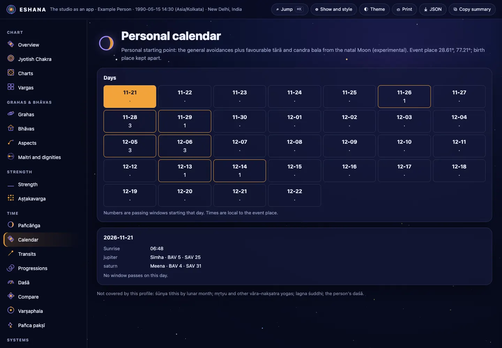</a><br/><b>📅 Personal calendar</b><br/><sub>Muhūrta windows with tārā and candra bala; export CSV or ICS.</sub></td>
<td><a href="https://neo-pragnya.github.io/ESHANA/reports/example-studio-app.html#/horary">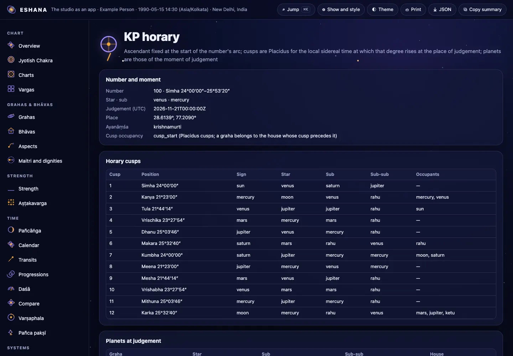</a><br/><b>🎯 KP horary</b><br/><sub>Numbers 1–249; cusps within 0.07″ of an independent reference.</sub></td>
<td><a href="https://neo-pragnya.github.io/ESHANA/reports/example-studio-app.html#/compare">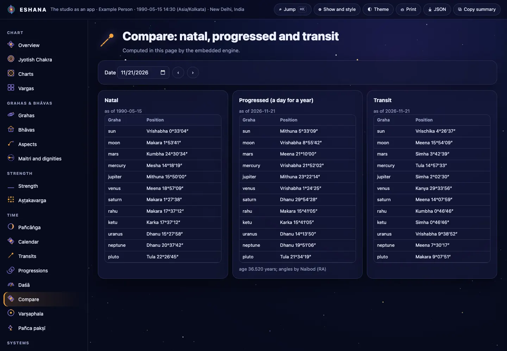</a><br/><b>🔁 Compare</b><br/><sub>Natal, progressed and transit side by side, recomputed in the page.</sub></td>
</tr>
<tr>
<td><a href="https://neo-pragnya.github.io/ESHANA/reports/reference-ramana.html#/dasha/chara">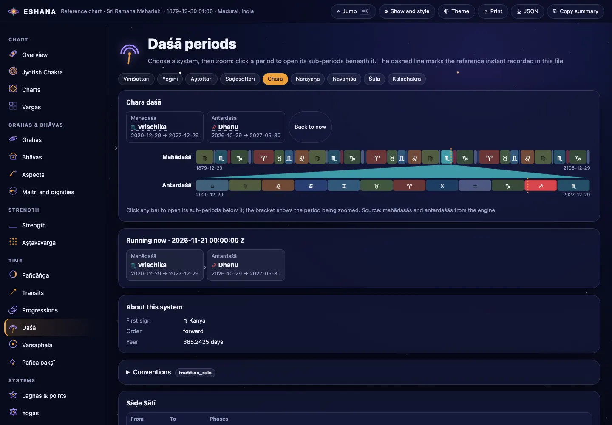</a><br/><b>⏳ Daśās</b><br/><sub>Sixteen systems, including seven conditional daśās that say whether their condition holds.</sub></td>
<td><a href="https://neo-pragnya.github.io/ESHANA/reports/reference-ramana.html#/strength">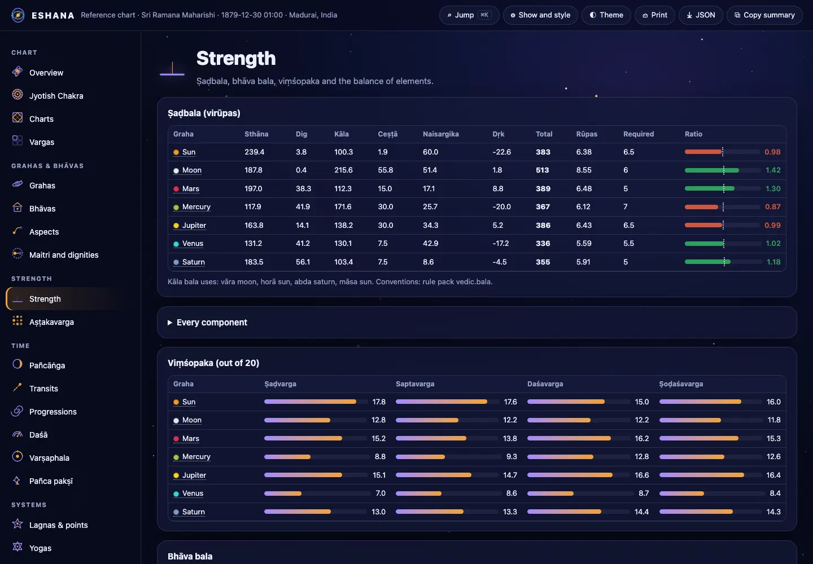</a><br/><b>💪 Strength</b><br/><sub>Ṣaḍbala against the required minimum, bhāva bala and viṃśopaka.</sub></td>
<td><a href="https://neo-pragnya.github.io/ESHANA/reports/example-birth-chart.html#/human-design">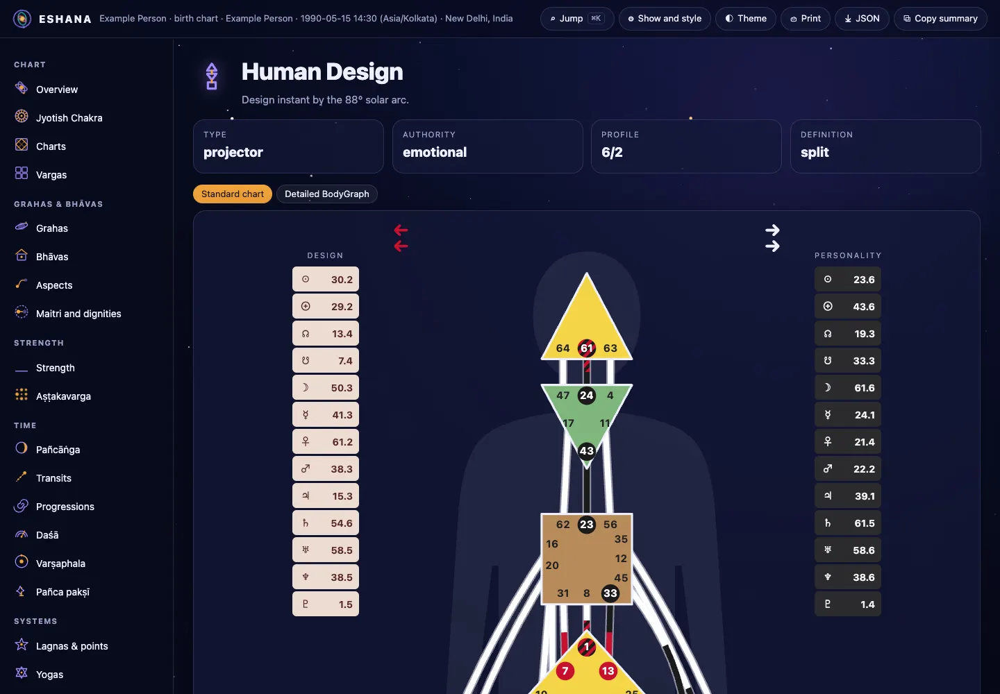</a><br/><b>🧬 Human Design</b><br/><sub>The design instant by the 88° solar arc, gates, channels and properties.</sub></td>
</tr>
</table>

<details>
<summary><b>🖼️ All 23 studio views</b> (click to open)</summary>

<!-- GALLERY:START -->
<table>
<tr><td width="25%" valign="top"><a href="https://neo-pragnya.github.io/ESHANA/reports/reference-ramana.html#/chakra"></a><br/><b>Jyotish Chakra</b><br/><sub>The Graha-Nakshatra Mandala: rāśis, nakshatras, padas and every graha, with the D1 chart in the centre. Hover details sit beside the wheel.</sub></td><td width="25%" valign="top"><a href="https://neo-pragnya.github.io/ESHANA/reports/reference-ramana.html#/charts"></a><br/><b>South and North Indian charts</b><br/><sub>Ārūḍha padas at the top of each rāśi, aspect marks at the bottom; crowded North Indian houses fit their shape.</sub></td><td width="25%" valign="top"><a href="https://neo-pragnya.github.io/ESHANA/reports/reference-ramana.html#/vargas"></a><br/><b>Divisional charts</b><br/><sub>D1 to D60 side by side.</sub></td><td width="25%" valign="top"><a href="https://neo-pragnya.github.io/ESHANA/reports/reference-ramana.html#/aspects">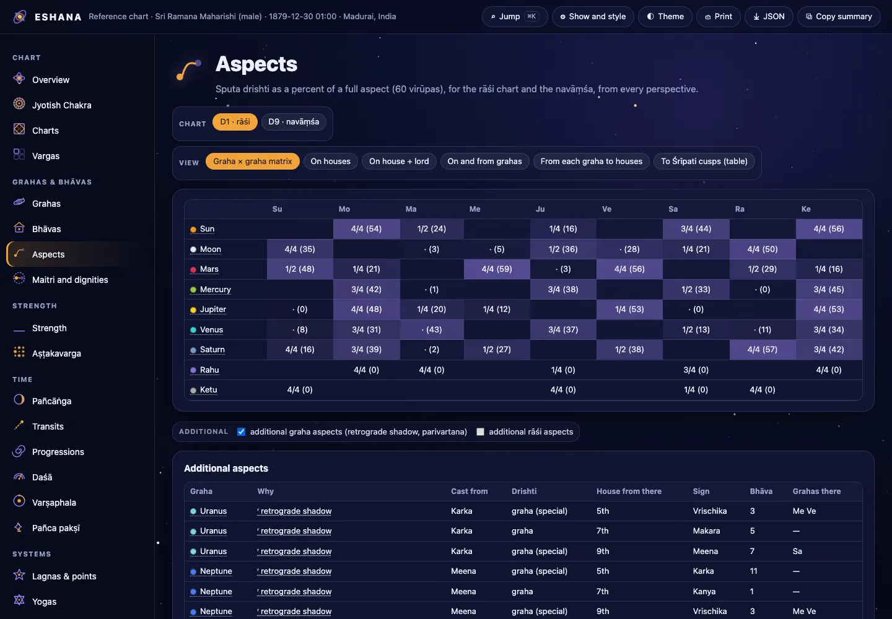</a><br/><b>Aspects</b><br/><sub>Graha drishti, rāśi drishti and sputa drishti in virūpas, on grahas, houses and cusps.</sub></td></tr>
<tr><td width="25%" valign="top"><a href="https://neo-pragnya.github.io/ESHANA/reports/reference-ramana.html#/houses">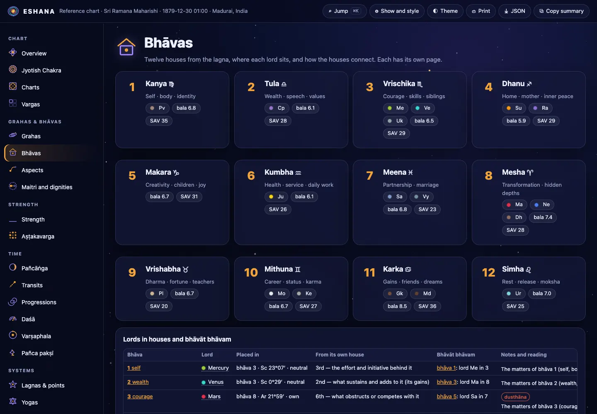</a><br/><b>Bhāvas</b><br/><sub>Every house, where its lord sits, and lordships in D1, D9 and D10 with the exchanges between lords.</sub></td><td width="25%" valign="top"><a href="https://neo-pragnya.github.io/ESHANA/reports/reference-ramana.html#/maitri">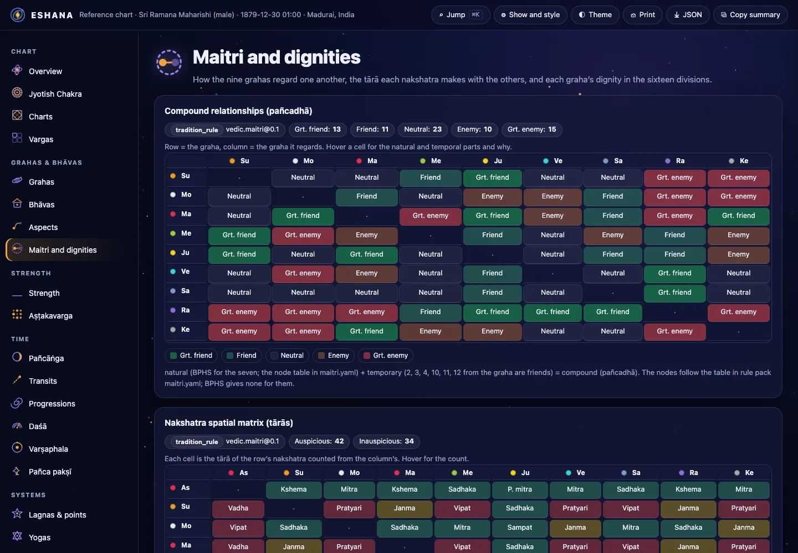</a><br/><b>Maitri and dignities</b><br/><sub>Compound relationships of the nine grahas, the nakshatra tārā matrix and dignities in 16 divisions.</sub></td><td width="25%" valign="top"><a href="https://neo-pragnya.github.io/ESHANA/reports/reference-ramana.html#/strength"></a><br/><b>Strength</b><br/><sub>Ṣaḍbala with the cut-off at the required minimum, bhāva bala and viṃśopaka.</sub></td><td width="25%" valign="top"><a href="https://neo-pragnya.github.io/ESHANA/reports/reference-ramana.html#/ashtakavarga">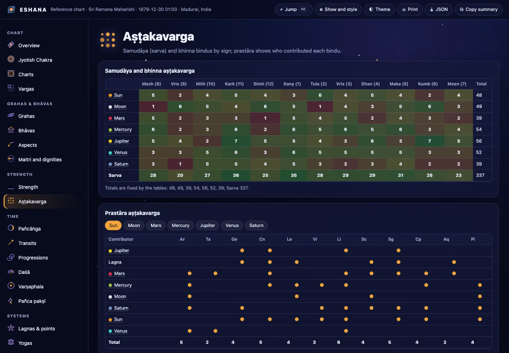</a><br/><b>Aṣṭakavarga</b><br/><sub>Bhinna and sarva aṣṭakavarga.</sub></td></tr>
<tr><td width="25%" valign="top"><a href="https://neo-pragnya.github.io/ESHANA/reports/reference-ramana.html#/dasha/chara"></a><br/><b>Daśā</b><br/><sub>Nine daśā systems; the zoom opens five levels deep. Shown: Chara daśā.</sub></td><td width="25%" valign="top"><a href="https://neo-pragnya.github.io/ESHANA/reports/reference-ramana.html#/yoga/parivartana">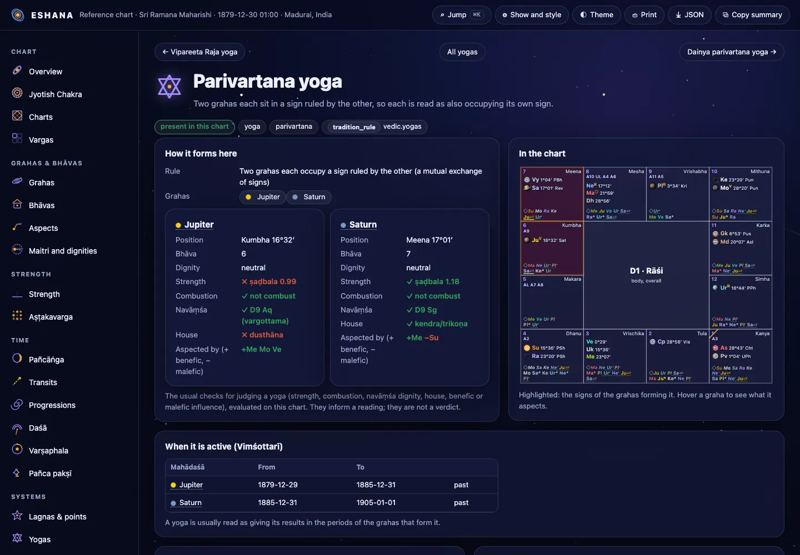</a><br/><b>Yogas</b><br/><sub>Each yoga present, with how it forms, strength checks, timing and its reading. Shown: the Jupiter–Saturn parivartana.</sub></td><td width="25%" valign="top"><a href="https://neo-pragnya.github.io/ESHANA/reports/reference-ramana.html#/aux/sahams">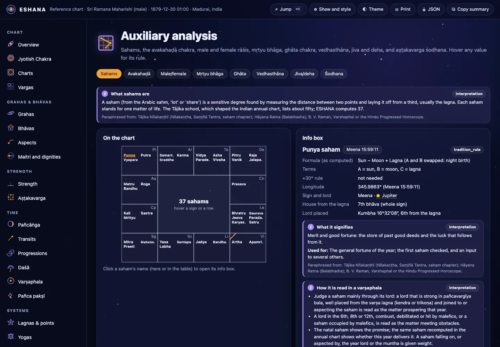</a><br/><b>Sahams</b><br/><sub>37 sahams on the chart, each with an info box: formula as computed, placement and meaning.</sub></td><td width="25%" valign="top"><a href="https://neo-pragnya.github.io/ESHANA/reports/reference-ramana.html#/chakras/sbc">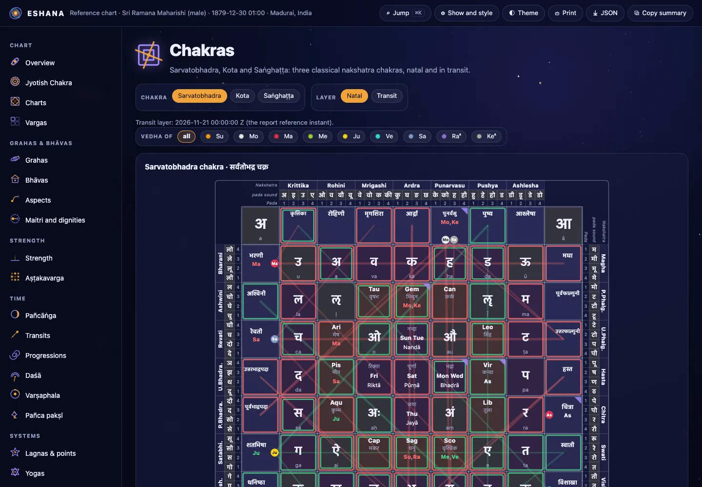</a><br/><b>Sarvatobhadra</b><br/><sub>The 9×9 chakra framed by nakshatra, pada-sound and pada bands, with vedha lines and borders.</sub></td></tr>
<tr><td width="25%" valign="top"><a href="https://neo-pragnya.github.io/ESHANA/reports/reference-ramana.html#/chakras/kota">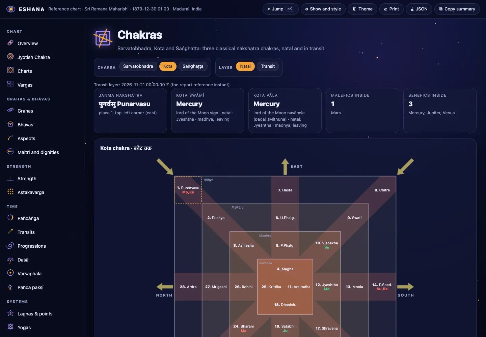</a><br/><b>Kota chakra</b><br/><sub>The fort: Bāhya, Prākāra, Madhya and Stambha, with the paths in and out.</sub></td><td width="25%" valign="top"><a href="https://neo-pragnya.github.io/ESHANA/reports/reference-ramana.html#/annual">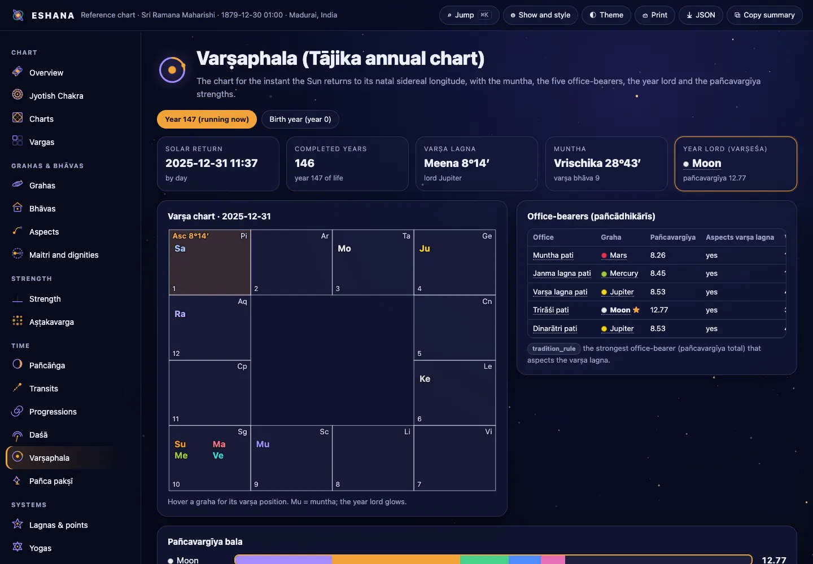</a><br/><b>Varṣaphala</b><br/><sub>The annual chart, muntha, office-bearers and the five-fold strengths.</sub></td><td width="25%" valign="top"><a href="https://neo-pragnya.github.io/ESHANA/reports/reference-ramana.html#/pakshi">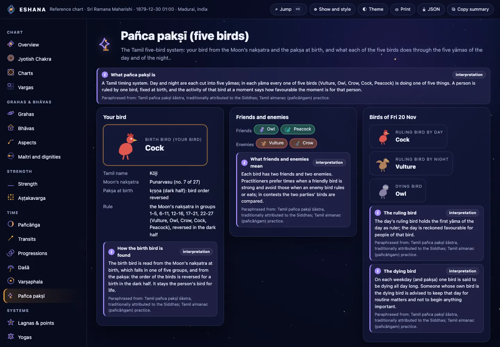</a><br/><b>Pañca pakṣī</b><br/><sub>The five birds through the day and the night, the current yāma, and the sub-periods.</sub></td><td width="25%" valign="top"><a href="https://neo-pragnya.github.io/ESHANA/reports/reference-ramana.html#/kp">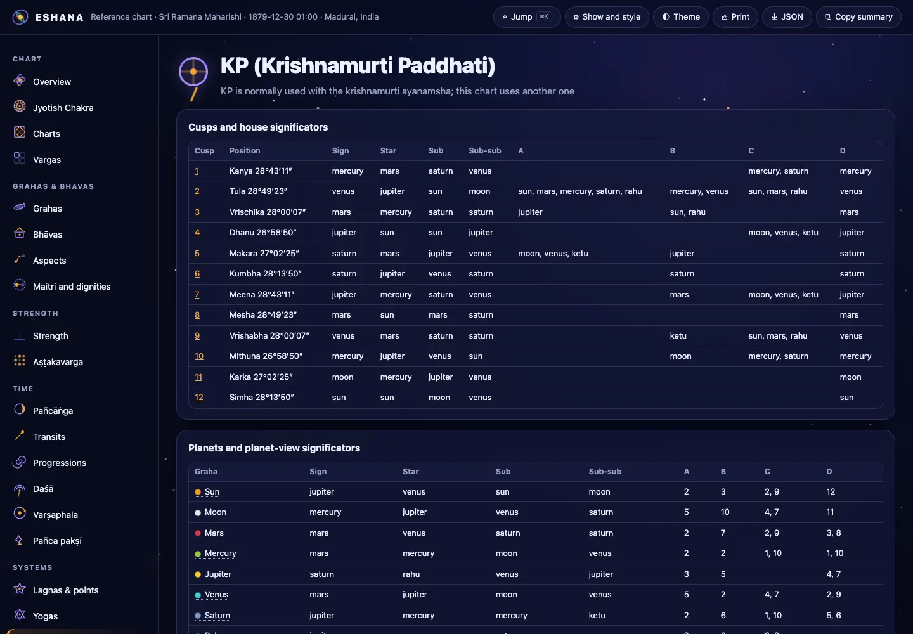</a><br/><b>KP</b><br/><sub>Sub-lords, cusps and significator tables by bhāva and by graha.</sub></td></tr>
<tr><td width="25%" valign="top"><a href="https://neo-pragnya.github.io/ESHANA/reports/reference-ramana.html#/panchanga">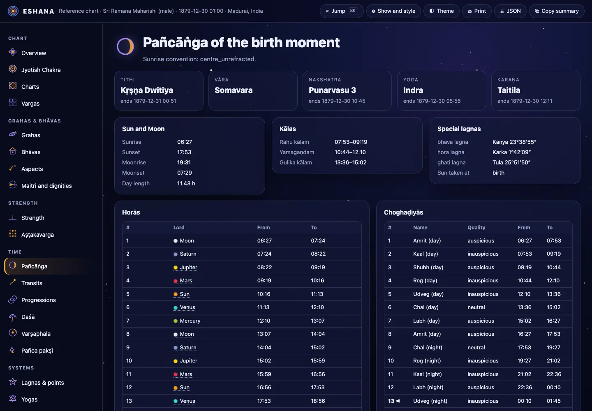</a><br/><b>Pañcāṅga</b><br/><sub>Tithi, vāra, nakshatra, yoga and karaṇa at birth.</sub></td><td width="25%" valign="top"><a href="https://neo-pragnya.github.io/ESHANA/reports/example-birth-chart.html#/human-design"></a><br/><b>Human Design</b><br/><sub>The standard BodyGraph with gates, channels and properties.</sub></td><td width="25%" valign="top"><a href="https://neo-pragnya.github.io/ESHANA/reports/example-birth-chart.html#/numerology">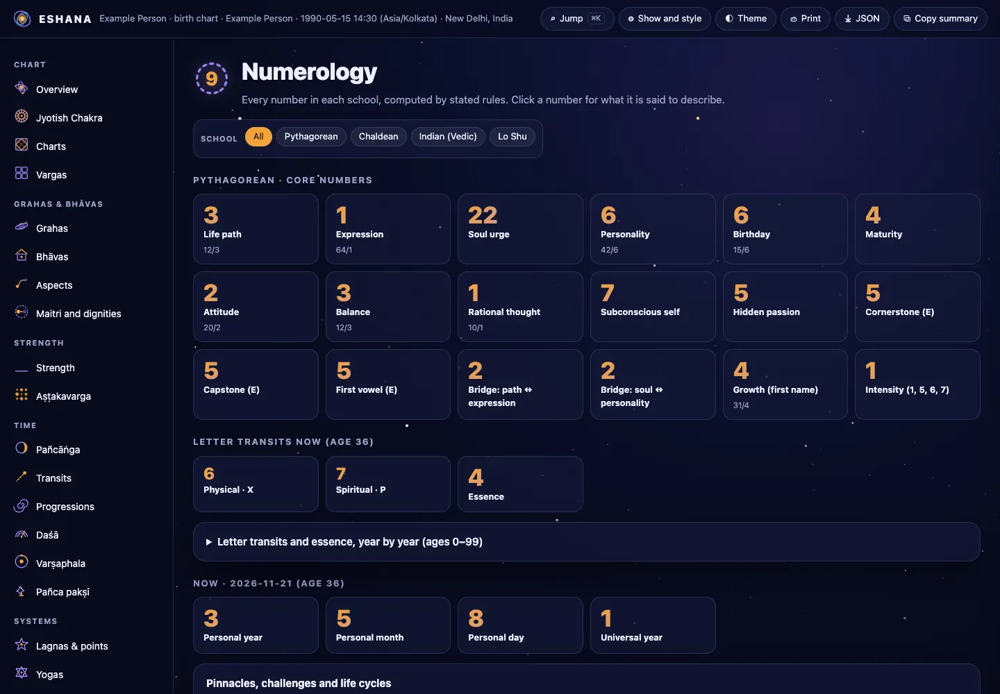</a><br/><b>Numerology</b><br/><sub>Every school's numbers, the Lo Shu grid and the Kua number.</sub></td><td width="25%" valign="top"><a href="https://neo-pragnya.github.io/ESHANA/reports/example-studio-app.html#/calendar"></a><br/><b>Personal calendar</b><br/><sub>Muhūrta windows for 31 days with tārā and candra bala from the birth chart; export as CSV or ICS.</sub></td></tr>
<tr><td width="25%" valign="top"><a href="https://neo-pragnya.github.io/ESHANA/reports/example-studio-app.html#/horary"></a><br/><b>KP horary</b><br/><sub>Number 100 fixes the Ascendant; Placidus cusps, sub-lords and significators at the moment of judgement.</sub></td><td width="25%" valign="top"><a href="https://neo-pragnya.github.io/ESHANA/reports/example-studio-app.html#/compare"></a><br/><b>Compare workspace</b><br/><sub>Natal, progressed and transit positions side by side, recomputed offline by the embedded engine.</sub></td><td width="25%" valign="top"><a href="https://neo-pragnya.github.io/ESHANA/reports/example-studio-app.html#/playground">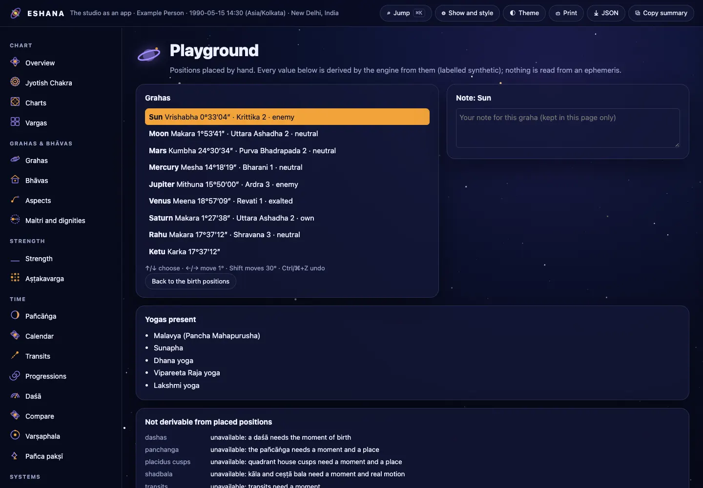</a><br/><b>Playground</b><br/><sub>Place grahas by keyboard and see what follows; factors that need a real moment are listed as unavailable.</sub></td></tr>
</table>
<!-- GALLERY:END -->

</details>

**Also in the studio:**
- 🖼️ **Download any chart as PNG or SVG**, exactly as shown: your layers, filters, rotation, theme and language. The PNG
  is print-sized with a caption, and the SVG opens in any editor.
- 🌐 **Interface language** as a reader setting: English by default, Hindi included. Labels only, never values.
- ⌨️ **Keyboard first**: ⌘K palette, a playground driven by the arrow keys with undo, focus rings everywhere.
- 🌗 **Light and dark themes**, every page and every form control checked for contrast in a real browser.

👉 [**Open the live studio**](https://neo-pragnya.github.io/ESHANA/reports/example-studio-app.html) ·
[Studio guide](docs/guides/html-report.md)

---

## 📝 A new chart from a form

`eshana-report new` is for people who would rather type the birth details than write options. It starts a one-shot
web form on your machine, waits, and stops as soon as one valid chart is written.

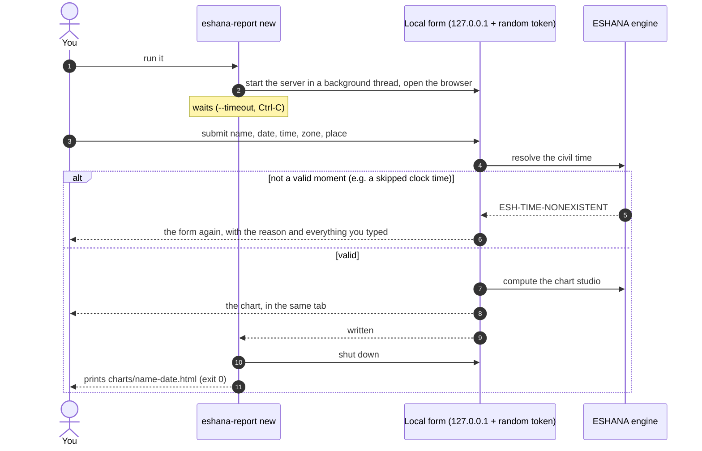

- 🔐 Loopback only, a random token in every URL, `Host` and `Origin` checked, no external assets.
- 🧾 Never overwrites a file (`-2`, `-3` … are added); `--library` saves the birth as a new profile revision.
- ⏱️ `--timeout` (exit 3) and Ctrl-C (exit 130) write nothing. The path is the last line on stdout:
  `open "$(eshana-report new)"`.

---

## 🔭 What it computes

| Area | Highlights |
|---|---|
| 🕰️ **Time and positions** | IANA zones with historic offsets (war time, double summer time, local mean time); ten bodies plus the nodes, apparent geocentric; an `analytic` provider with no data files and an `spk` provider for JPL kernels |
| 🌙 **Jyotiṣa** | rāśi, nakshatra and pada; vargas D1–D60 plus D81, D108 and D144; **ten ayanāṃśas**; graha and rāśi drishti; aṣṭakavarga; ṣaḍbala; Jaimini kārakas and ārūḍhas; yogas and doshas; sahams; Sarvatobhadra and Kota chakras; varṣaphala; pañca pakṣī |
| ⏳ **Daśās** | Vimśottarī to five levels, Yoginī, Chara and more, **sixteen systems** in all, including seven conditional daśās that report whether their condition holds |
| 🗓️ **Timing** | stations and retrograde intervals; exact crossings and aspects; **dated aṣṭakavarga**; pañcāṅga with horā, choghaḍiyā and the kālams |
| 🪔 **Muhūrta** | windows as exact `[start, end)` intervals under versioned profiles; an empty result says which rule removed every window; **personal and pair calendars** (JSON, CSV, ICS) |
| 🎯 **KP** | sub-lords and significators; **horary numbers 1–249** with Placidus cusps; cusp-occupancy methods named, the natal default unchanged |
| 💞 **Matching** | the 36-point aṣṭakūṭa, unchanged byte for byte; rajju, vedha, mahendra, strī-dīrgha and Maṅgala doṣa with every cancellation listed; cross-chart factors |
| ♈ **Western** | tropical; whole-sign, equal and Placidus (refused where undefined); aspects with the applying state; **secondary progressions** with named angle methods |
| 🧬 **Human Design** | the design instant by solving the 88° solar arc (not "88 days"), gates, lines, channels, centres, type, authority and profile |
| 🔢 **Numerology** | Pythagorean and Chaldean as separate schemas, Lo Shu and Kua, compound numbers, letter transits |
| 🧪 **Research (experimental)** | each score is written up first (factors, weights, worked examples); one window-ranking model, labelled experimental |

<details>
<summary><b>🌌 The fourteen ayanāṃśas</b></summary>

| id | | id | |
|---|---|---|---|
| `lahiri` | Chitrapakṣa, the Indian national standard | `jn_bhasin` | J. N. Bhasin |
| `raman` | B. V. Raman | `ushashashi` | Usha–Shashi |
| `krishnamurti` | KP (the default for KP horary) | `sassanian` | Sassanian |
| `fagan_bradley` | the Western sidereal standard | `deluce` | De Luce |
| `yukteshwar` | Sri Yukteshwar | `djwhal_khul` | Djwhal Khul |
| `true_citra` | Spica held at 180° | `true_pushya` | δ Cancri held at 106° |
| `true_revati` | ζ Piscium held at 359°50′ | `true_mula` | λ Scorpii held at 240° |

Each mean model is defined by its epoch and rate (`info` → `ayanamsha_definitions`) and checked against an
independent reference from 1800 to 2100: worst error 0.05″. The four true models follow their star (Hipparcos
position and proper motion, with aberration and light deflection): within 0.62″ of the reference over 1800–2200.

</details>

---

## 🪔 Muhūrta, step by step


Every factor (the kālams, tithi, nakshatra, karaṇa, horā, choghaḍiyā, tārā and candra bala) is a **timeline of exact
intervals**. A profile is a list of named constraints. The engine cuts the range at every boundary, evaluates each
piece and merges equal neighbours, so a window starts and ends exactly where a factor changes. The picture above is
drawn from a real run ([its generator](assets/readme/src/muhurta_svg.py)).

> [!IMPORTANT]
> The profiles that combine rules (`general_auspicious`, `personal_general`, `pair_general`, `travel`) are labelled
> **experimental** until a practitioner has reviewed them. Each one lists what it does **not** cover (śūnya tithis,
> vāra–nakṣatra yogas, lagna śuddhi), and that list travels with every result.

---

## 🧪 One engine, every question


Every line in these walkthroughs is real output from eshana 0.4 (regenerate them from
[`assets/readme/src/`](assets/readme/src)).

---

## 🐍 Python cookbook

Every example below was run against eshana 0.4.1; the comments show what it returned.

```python
from eshana import ChartEngine, Context

eng = ChartEngine()
birth = Context.from_local_birth("1990-05-15", "14:30", "Asia/Kolkata", 28.6139, 77.2090)

# 🪔 muhūrta windows for a day in Chennai
mw = eng.muhurta_windows(13.08, 80.27, "2026-12-01T00:30:00Z", "2026-12-02T00:30:00Z",
                         timezone="Asia/Kolkata", profile="general_auspicious")
len(mw["windows"]), mw["windows"][0]["start_local"]       # (5, '2026-12-01T06:00:00+05:30')
mw["removed_minutes"]["no_rahu_kalam"]                    # 85.6…, and which rule removed what

# 📅 a personal calendar as an ICS file for any calendar app
cal = eng.personal_calendar(birth, 28.6139, 77.2090, "2026-12-01T00:00:00Z", "2026-12-08T00:00:00Z",
                            timezone="Asia/Kolkata", format="ics")
cal["media_type"]                                         # 'text/calendar'
open("muhurta.ics", "w").write(cal["content"])

# 🎯 KP horary: number 100, judged now in Chennai
kp = eng.kp_horary(100, Context.from_utc("2026-11-24T06:00:00Z", 13.08, 80.27))
kp["ascendant"]["sign"]["name"], kp["ascendant"]["sign"]["dms"]   # ('Simha', '24°00′00″')

# 🔄 Mercury's stations and retrograde intervals in 2026
st = eng.stations("mercury", "2026-01-01T00:00:00Z", "2027-01-01T00:00:00Z")
st["stations"][0]["station"], st["stations"][0]["utc"]   # ('retrograde', '2026-02-26T06:50:13.770Z')
round(st["retrograde_intervals"][0]["days"], 1)           # 22.5

# 📈 secondary progressions with a named angle method
pr = eng.progressions(birth, "2026-11-24T00:00:00Z", angle_method="naibod_ra")
round(pr["calculation"]["age_years"], 3)                  # 36.528

# 📋 every method family and id the engine knows
[f["family"] for f in eng.methods()["families"]][:4]      # ['ayanamsha', 'house_system', 'node_model', 'divisional_chart']
```

Anything else is one raw request away: `eshana.execute({"op": "…", …})` returns the envelope or raises
`EshanaError` with a stable `ESH-*` code. The request format: [docs/reference/request.md](docs/reference/request.md).

---

## 📐 Formulas, written down

Rules are data, and the ones people ask about most are short enough to read here.

**Vimśottarī balance at birth.** With $f$ the fraction of the birth nakshatra the Moon has already crossed and
$Y_{\text{lord}}$ the years of that nakshatra's lord, the first daśā has

```math
\text{balance} = (1 - f)\, Y_{\text{lord}}, \qquad \sum_{\text{lords}} Y = 120 \text{ years}
```

**Experimental window score** (`research.window_score@0.1`). Each available factor gives $s_i \in [0, 1]$ with weight
$w_i$; missing factors are left out and their weight is spread over the rest, so the score never pretends to know more
than it does:

```math
S = 100 \sum_{i \in A} \frac{w_i}{\sum_{j \in A} w_j}\, s_i, \qquad \text{coverage} = \sum_{i \in A} w_i \;\;(\text{no score below } 0.5)
```

The specification, with hand-worked examples that are also the unit tests:
[docs/design/research-models.md](docs/design/research-models.md).

---

## ⚙️ How it works


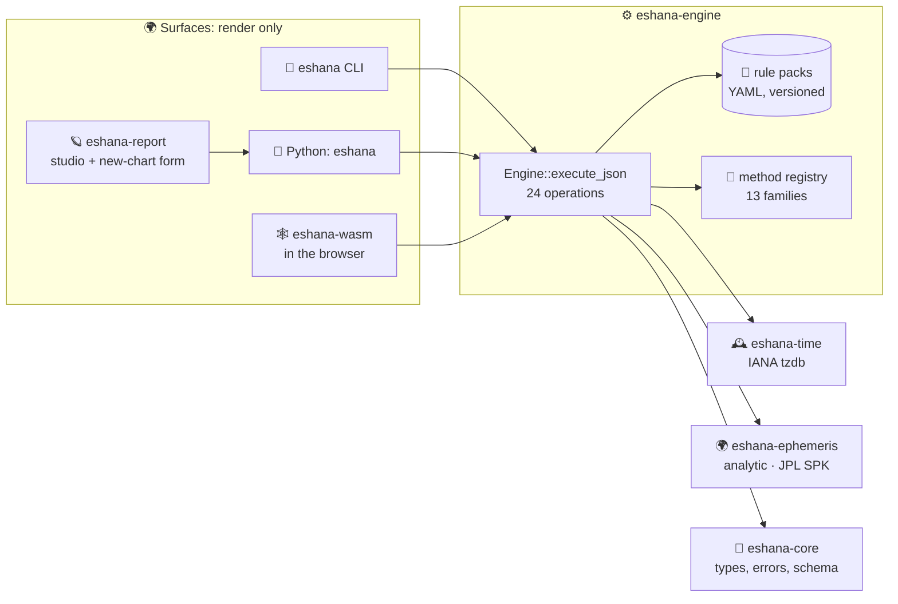

- **One entry point.** `Engine::execute_json` takes a JSON request (with an `op`) and returns a JSON envelope. The CLI,
  the Python package (pyo3) and the WebAssembly build (three C functions, no bindings generator) are thin shells.
- **Rule packs are data.** YAML files with versions and method ids, printed by `eshana rulesets`. A changed formula is
  a new rule version, with golden fixtures that show the difference.
- **Surfaces never compute.** The studio renders envelopes; it never works out a factor of its own.

---

## 🛡️ Guarantees

Each of these is a scenario in the release gate (`make acceptance`: **122 scenarios**, all passing):

| | Guarantee | Error code |
|---|---|---|
| 🚫 | Sidereal without an ayanāṃśa is refused, unless you ask for defaults, in which case the default is recorded | `ESH-CONFIG` |
| ⏰ | A local time that the clocks skipped is refused | `ESH-TIME-NONEXISTENT` |
| 🔁 | A local time that happened twice is refused until you pick `earliest` or `latest` | `ESH-TIME-AMBIGUOUS` |
| 🧊 | Placidus beyond the polar circle is refused, not approximated | `ESH-LATITUDE` |
| ❓ | An unknown birth time gets intervals, not noon; the Ascendant and houses are never invented | `ESH-TIME-UNCERTAIN` |
| 🧩 | An unknown method id is refused, never swapped for a default | `ESH-METHOD` |
| 📏 | A search past its documented limit is refused or marked `truncated` | `ESH-LIMIT` |
| 🔂 | The same request returns the same bytes, with a `config_hash` naming the settings | |
| 🙈 | A chart writes nothing to disk and sends nothing anywhere | |
| 🧷 | Unavailable is not zero: a factor that cannot be computed says so, and says what is missing | |

---

## 📏 Accuracy, measured

Not promised: measured against independent references and written down.

| What | Against | Result |
|---|---|---|
| 🌍 Positions, `spk` provider | an independent JPL DE440s pipeline | **0.3″** |
| 🌍 Positions, `analytic` provider (40 charts) | Swiss Ephemeris (offline oracle) | Sun 0.4″, planets ≤ 1.4″ (Neptune 4.5″), Moon 6″ worst |
| 🧭 Ascendant and cusps | Swiss Ephemeris | **3.2″** worst |
| 🎯 KP horary cusps | Swiss Ephemeris `houses_armc` | **0.07″** |
| 📐 Ten ayanāṃśas, 1800–2100 | Swiss Ephemeris | **0.05″** worst (De Luce) |
| ⏱️ Stations and crossings | Swiss Ephemeris event search | within the stated solver tolerance |
| 📚 Published charts | printed reference values | see the accuracy report |

> [!TIP]
> The `analytic` provider (VSOP87 since 0.5.0) is arc-second class for the Sun and planets with no data files. For
> sub-arc-second work, historical dates, asteroids or Chiron, use the `spk` provider with a JPL kernel
> (`eshana kernel list`, `--provider spk --spk de440`).

The Swiss Ephemeris is used **only** as an offline test oracle: never bundled, never linked. Details:
[accuracy report](benchmarks/accuracy/birth-chart-accuracy.md) · [provider accuracy](benchmarks/golden/accuracy.md) ·
[accuracy guide](docs/guides/accuracy-suite.md).

---

## 📖 Reference

<!-- REFERENCE:START -->
<details>
<summary><b>⚙️ All 29 operations</b> (the <code>op</code> of a request)</summary>

| | `op` | What it answers |
|---|---|---|
| 🌍 | `positions` | apparent geocentric positions only |
| 🪐 | `chart` | a Vedic (sidereal) or Western (tropical) chart, with the requested features |
| 🧬 | `human_design` | design instant by the 88° solar arc, gates, lines, channels, type, authority, profile |
| 🔢 | `numerology` | name and birth-date numerology under a named school |
| 🔁 | `compare` | the same input under two configurations, with a diff of what changed |
| 🕸️ | `graph` | a symbolic graph of a chart: JSON, Mermaid or GraphML, no causal edges |
| 🌅 | `panchanga` | tithi, vāra, nakshatra, yoga, karaṇa, sunrise, horā, choghaḍiyā and the kālams |
| 💞 | `matching` | aṣṭakūṭa matching plus the supplementary rules, each cancellation listed |
| 📈 | `ephemeris` | longitudes at regular steps (transit animation, progressions) |
| 🚪 | `ingresses` | sign ingresses of one body between two instants |
| 🔄 | `stations` | stations and retrograde intervals, clipped flags at the range ends |
| 🎯 | `crossings` | when a body reaches a point or an aspect to it, with touches reported apart |
| 📜 | `rulesets` | the built-in YAML rule packs |
| 📐 | `methods` | every method family and id the engine implements |
| 🗓️ | `ashtakavarga_transits` | dated aṣṭakavarga: the natal bindus each graha reads, between ingresses |
| 🪔 | `muhurta_windows` | muhūrta windows composed from factor timelines under a profile |
| 📅 | `personal_calendar` | windows with tārā and candra bala from a birth; JSON, CSV or ICS |
| 👫 | `pair_calendar` | windows that suit two people and the event, each explained |
| 📆 | `progressions` | secondary progressions with fractional age and named angle methods |
| 🔢 | `kp_table` | the KP 1–249 horary number table |
| 🎯 | `kp_horary` | a KP horary chart: the number fixes the Ascendant |
| 🌄 | `rise_set` | rise, upper transit and set of any body, and twilight, for local days at a place |
| 🔁 | `returns` | solar, lunar or any body's returns to its natal longitude, with a chart at each (relocatable) |
| 🚶 | `gochara` | transits counted from the natal Moon and lagna, with retrograde and combustion intervals |
| 🌑 | `eclipses` | solar and lunar eclipses: type, time of greatest eclipse, magnitude, γ |
| 💑 | `synastry` | two charts compared: inter-aspects, house overlays, midpoint composite, Davison chart |
| 🧪 | `synthetic_chart` | positions you place by hand, labelled synthetic (the playground) |
| 📊 | `research_window_score` | the experimental window score, with coverage and sensitivity |
| ℹ️ | `info` | versions, operations, method families and ayanāṃśa definitions |

Fields of each: [docs/reference/request.md](docs/reference/request.md).
</details>

<details>
<summary><b>🧰 All 31 CLI commands</b></summary>

| Command | What it does |
|---|---|
| `eshana positions` | Apparent geocentric positions only |
| `eshana chart` | A Vedic (sidereal) or Western (tropical) chart |
| `eshana human-design` | Human Design: design instant, gates, lines, channels, type, authority, profile |
| `eshana numerology` | Name and birth-date numerology |
| `eshana compare` | Same input under two configurations, with a diff of what changed |
| `eshana graph` | Symbolic graph of a chart: json, mermaid, graphml, svg, drawio or chitkala |
| `eshana panchanga` | Panchanga and day divisions (sunrise, tithi, nakshatra, yoga, karana, hora, choghadiya, rahu kalam) |
| `eshana ashtakavarga-transits` | Transit Ashtakavarga: the natal BAV/SAV cells each graha reads, as segments between ingresses |
| `eshana muhurta` | Muhurta windows: factor timelines over a range composed under a profile and constraints |
| `eshana calendar` | Personal calendar: muhurta windows with tara and chandra bala from a birth, day summaries; json, csv or ics |
| `eshana pair-calendar` | Pair calendar: windows that suit both people and the event; each window explained by both and the event |
| `eshana progress` | Secondary progressions: a day for a year, fractional age, angles under a named method |
| `eshana kp-table` | The KP 1-249 horary number table |
| `eshana kp-horary` | KP horary chart: the number fixes the Ascendant; the moment and place are those of judgement |
| `eshana matching` | Ashtakoota compatibility of two births: a = the role classical tables give the groom, b = the bride |
| `eshana ephemeris` | Longitudes at regular steps (transit animation, progressions) |
| `eshana ingresses` | Sign ingresses of one body between two instants |
| `eshana stations` | Stations and retrograde intervals of one body between two instants |
| `eshana crossings` | When a body reaches a longitude, or an aspect to it, between two instants |
| `eshana rulesets` | Print the built-in YAML rule packs |
| `eshana methods` | List every method family and method id the engine implements |
| `eshana request` | Send a raw JSON request from a file, or `-` for stdin |
| `eshana doctor` | Show the environment, providers, rule packs and error codes |
| `eshana explain` | Explain a stable error code, e.g. ESH-LATITUDE |
| `eshana schema` | Print the JSON Schema of the result envelope |
| `eshana rise-set` | Rise, upper transit and set of bodies, and twilight, for local days at a place |
| `eshana returns` | Solar, lunar or any body's returns to its natal longitude in a range, with a chart at each |
| `eshana gochara` | Gochara: transits counted from the natal Moon and lagna, with retrograde and combustion intervals |
| `eshana synastry` | Synastry of two births: inter-aspects, house overlays, a midpoint composite and a Davison chart |
| `eshana eclipses` | Solar and lunar eclipses in a range: type, time of greatest eclipse, magnitude |
| `eshana kernel` | JPL kernels: `list` the ones ESHANA knows, `verify PATH|NAME` against NAIF's checksum, `path NAME` |

Every command prints one JSON envelope; `--compact` for one line. Errors print an error envelope and exit 2.
</details>

<details>
<summary><b>📐 All 13 method families</b> (<code>eshana methods</code>)</summary>

| Family | Method ids |
|---|---|
| `ayanamsha` | `lahiri`, `raman`, `krishnamurti`, `fagan_bradley`, `yukteshwar`, `jn_bhasin`, `ushashashi`, `sassanian`, `deluce`, `djwhal_khul`, `true_citra`, `true_revati`, `true_pushya`, `true_mula` |
| `house_system` | `whole_sign`, `equal`, `placidus`, `porphyry`, `sripati`, `koch`, `regiomontanus`, `campanus`, `alcabitius`, `topocentric`, `morinus`, `meridian` |
| `node_model` | `mean`, `true` |
| `divisional_chart` | `d1`, `d2`, `d3`, `d4`, `d5`, `d6`, `d7`, `d8`, `d9`, `d10`, `d12`, `d16`, `d20`, `d24`, `d27`, `d30`, `d40`, `d45`, `d60` |
| `year_convention` | `julian`, `gregorian`, `savana`, `sidereal` |
| `sunrise` | `upper_limb_refracted`, `centre_refracted`, `centre_unrefracted` |
| `event_search` | `ingresses`, `stations`, `crossings` |
| `numerology_school` | `pythagorean`, `chaldean`, `hebrew_gematria`, `abjad` |
| `kp_cusp_occupancy` | `cusp_start`, `cusp_midpoint` |
| `muhurta_profile` | `daily_avoidances`, `general_auspicious`, `abhijit`, `brahma_muhurta`, `personal_general`, `pair_general`, `travel` |
| `varga_method` | `d2_parivritti`, `d3_parivritti`, `d81_navanavamsha`, `d108_ashtottaramsha_cyclic`, `d144_dvadasha_dvadashamsha`, `d30_parivritti`, `d60_parivritti`, `d150_parivritti` |
| `progression_angles` | `solar_arc_longitude`, `naibod_ra`, `quotidian` |
| `research_model` | `research.window_score@0.1` |

An id that is not listed is refused with `ESH-METHOD`, never replaced by a default.
</details>

<details>
<summary><b>🚨 All 14 error codes</b> (<code>eshana explain CODE</code>)</summary>

| Code | Meaning |
|---|---|
| `ESH-INPUT` | Malformed or out-of-range input |
| `ESH-CONFIG` | Conflicting or incomplete configuration |
| `ESH-TZ-UNKNOWN` | Unknown IANA time zone |
| `ESH-TIME-AMBIGUOUS` | Local time occurs twice; give a fold policy |
| `ESH-TIME-NONEXISTENT` | Local time was skipped by a DST change |
| `ESH-TIME-UNCERTAIN` | Result needs a more precise birth time |
| `ESH-RANGE` | Instant outside the provider's range |
| `ESH-BODY` | Provider cannot supply this body |
| `ESH-LATITUDE` | Houses undefined at this latitude |
| `ESH-PROVIDER` | Ephemeris provider failure |
| `ESH-RULES` | Rule-pack or numerology policy problem |
| `ESH-METHOD` | Method id not implemented; list them with the methods operation |
| `ESH-RANGE-INVALID` | Range end is not after its start |
| `ESH-LIMIT` | Request exceeds a documented work limit |

Codes are stable across versions: [docs/reference/errors.md](docs/reference/errors.md).
</details>
<!-- REFERENCE:END -->

---

## 🧩 Ways to use it

| You want… | Use | Example |
|---|---|---|
| 🪐 a chart to read, offline | `eshana-report` | `eshana-report --date … --tz … --lat … --lon … --live -o chart.html` |
| 📝 to type details, not flags | `eshana-report new` | a local form on 127.0.0.1 that writes the chart and stops |
| 🐍 numbers in Python | `eshana` | `eshana.execute({"op": "muhurta_windows", …})` or `ChartEngine()` |
| 🧰 JSON from a shell | `eshana` (installed with the package) | `eshana chart vedic …`, `eshana muhurta …`, `eshana kp-horary …` |
| 🗓️ a calendar file | `personal_calendar` | `format: "ics"` for any calendar app |
| 🕸️ the engine in a browser | `eshana-wasm` | three C functions, no bindings generator ([ADR-013](docs/adr/013-local-engine-adapter.md)) |

```bash
pip install eshana              # Python package + the eshana, eshana-report and eshana-mcp commands
uv tool install eshana          # or: the three commands on your PATH, in their own environment
eshana --version
```

`eshana` from the package is the full Rust CLI, compiled into the wheel (`python -m eshana` works too).
Prebuilt wheels cover macOS on Apple silicon and Linux x86_64 and aarch64 (abi3, CPython 3.9 and later); other
platforms build from the sdist, which needs a Rust toolchain. More in [ways to use ESHANA](docs/guides/ways-to-use.md).

---

## 🛠️ Development and releases

```bash
make verify            # fmt, clippy -D warnings, every Rust test, Python tests, tracker freshness, accuracy suite
make acceptance        # the Gherkin release gate (must say PROMOTE)
make studio-journeys   # real Chrome: every studio page, text hierarchy, downloads, contrast, the new-chart form
make docs-check        # docs, links, ADR index, and that the PyPI README matches this one
make preview           # local preview of the studio and the website
```

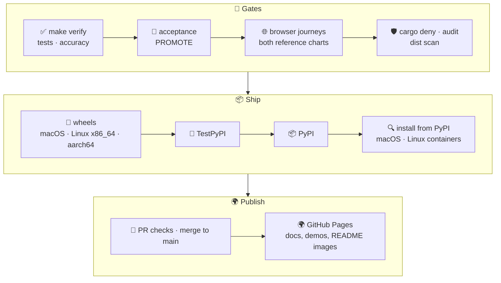

Work is tracked in [`planning/backlog.json`](planning/backlog.json), rendered as
[`planning/TRACKING.md`](planning/TRACKING.md), with exact status words: *proposed*, *implemented*, *verified*
(evidence required) and *released*. Releasing: [docs/guides/publishing.md](docs/guides/publishing.md).

<details>
<summary><b>🗺️ Repository map</b></summary>

| Path | What |
|---|---|
| `crates/` | `eshana-core`, `-time`, `-ephemeris`, `-engine` (rules and rule packs), `-cli`, `-python`, `-wasm` |
| `docs/` | concepts, guides, reference and ADRs; also the source of the website |
| `website/` | the Astro site: landing page, live demos, gallery |
| `acceptance/` | Gherkin capability scenarios, the release gate, and the browser journeys |
| `accuracy/`, `benchmarks/` | the birth-chart accuracy suite, golden fixtures and offline oracle data |
| `examples/` | example studio reports and the gallery screenshots, all generated by the real engine |
| `assets/readme/` | the animated SVGs on this page, with their sources and generators |
| `planning/` | the backlog, the tracker and the capability-expansion plan |
| `scripts/` | report, gallery, capability, tracker and PyPI-README generators and checks |

</details>

---

## ❓ FAQ

<details>
<summary><b>Does ESHANA tell me what my chart means?</b></summary>

No. It computes positions and applies named rules, and it labels each. `interpretations` is always empty. The studio
shows reading notes only where they are attributed to a source, kept apart from the engine's output.
</details>

<details>
<summary><b>Why was my birth time refused?</b></summary>

Because it did not exist, or happened twice. On a spring-forward night the clock jumps from 02:00 to 03:00, so 02:30
never happened (`ESH-TIME-NONEXISTENT`). On a fall-back night 01:30 happens twice (`ESH-TIME-AMBIGUOUS`); say which
with `--fold earliest` or `--fold latest`. Old records may need a fixed offset: `--offset-minutes 321` for local mean
time in Madurai in 1879.
</details>

<details>
<summary><b>Which ayanāṃśa, houses and nodes should I use?</b></summary>

ESHANA does not choose for you. Sidereal charts need an ayanāṃśa (`lahiri` is the common one). Houses default to
whole-sign for Vedic charts and nodes to mean, and both defaults are written into `provenance.assumptions`. KP horary
defaults to `krishnamurti` and Placidus, as KP defines it.
</details>

<details>
<summary><b>Does anything leave my machine?</b></summary>

No. The engine has no network code, a chart writes nothing to disk unless you ask it to, the studio is an offline file,
and `eshana-report new` listens on 127.0.0.1 only. Tests check that the studio file loads nothing from the network,
and release-gate scenarios check that a chart writes nothing to your project or home folder and that birth data is not
echoed to the terminal.
</details>

<details>
<summary><b>How do I cite a result?</b></summary>

Keep the envelope: `schema_version`, `provenance` (engine, provider, tz database and rule versions) and
`calculation.config_hash` identify exactly how it was computed. The same request returns the same bytes.
</details>

<details>
<summary><b>Can I use it from JavaScript?</b></summary>

Yes, through `eshana-wasm`: `eshana_alloc`, `eshana_execute` and `eshana_free` take and return the same JSON as
everywhere else. The studio's `--live` mode is that module, embedded. See [ADR-013](docs/adr/013-local-engine-adapter.md).
</details>

---

## 🤝 Status and honesty

- 📦 **Version 0.4**, on [PyPI](https://pypi.org/project/eshana/). Open source under Apache-2.0
  ([ADR-011](docs/adr/011-open-source-distribution.md)).
- 🧪 **Experimental pieces are labelled.** Muhūrta purpose presets and the research window score wait for a
  practitioner's review. The conditional daśās wait for published worked examples.
- 🔭 **Know the provider.** `analytic` is arc-second class (VSOP87; Pluto under an arc-minute); use `spk` with a JPL kernel when
  that matters.
- 🧭 Next steps: [docs/next-steps.md](docs/next-steps.md) · changes: [CHANGELOG.md](CHANGELOG.md) ·
  design record: [ESHANA_Project_Vision_and_Master_Plan.md](ESHANA_Project_Vision_and_Master_Plan.md).

<div align="center">

**Calculated · Derived by a named system · Never interpreted for you** 🌌

</div>
