# Architecture diagrams

These diagrams are **generated from code** ([`diagrams/arch_specs.py`](../../diagrams/arch_specs.py)) with the
Marvellous Architectures engine, so they change with the system and are never redrawn by hand. Each SVG plays its
numbered flow on GitHub and in the docs. The [interactive page](index.html) adds play, step and click-to-jump. Editable
draw.io files are in [`drawio/`](drawio/).

Rebuild: `make diagrams`.

## 1. System overview

One JSON entry point, `Engine::execute_json`, sits behind every surface. Time conversion, the ephemeris providers and
the rule packs are separate crates; their output is one envelope that the CLI prints, Python returns and the report
renders. See [architecture](../concepts/architecture.md).

## 2. The doctrine: Compute → Derive → Interpret

The engine computes and derives; it never interprets. When the input cannot support an answer, it refuses with a
stable error code. See [the epistemic model](../concepts/epistemic-model.md).

## 3. How accuracy is proven

Five independent layers, from the mathematics to JPL DE440s, the Swiss Ephemeris, published values (ProKerala,
the Lahiri definition) and a second implementation of every rule. See the
[accuracy suite](../guides/accuracy-suite.md).

## 4. Ways to use ESHANA

Terminal, Python, HTML report, notebook or app, and the planned bindings. See [ways to use](../guides/ways-to-use.md).

## 5. Report pipeline

From a request to one self-contained HTML file. See [HTML chart reports](../guides/html-report.md).
