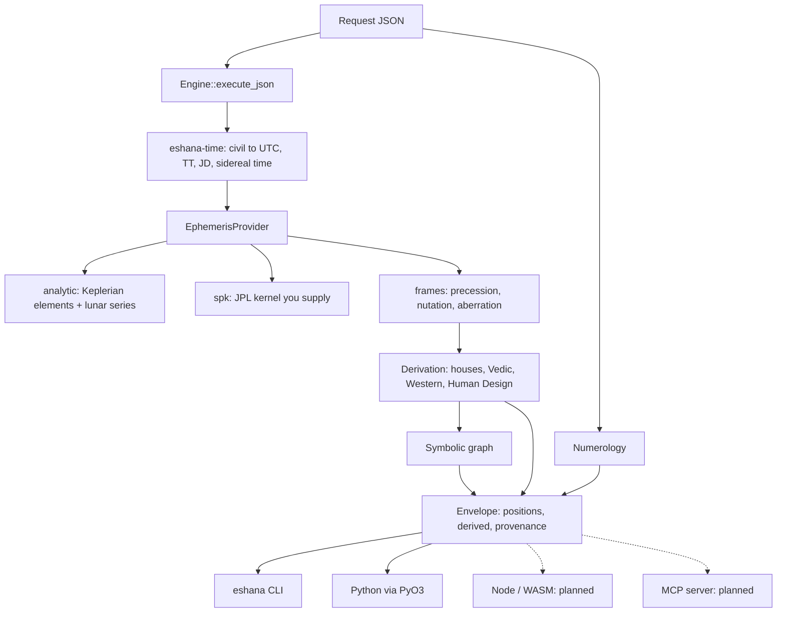

# Architecture

All five animated diagrams, generated from code, are on the [architecture diagrams](../architecture/diagrams.md) page.

## Crates

| Crate | Responsibility |
|---|---|
| `eshana-core` | typed angles, `Body`, `CalculationConfig`, `Epistemic`, `Provenance`, `DerivedAttribute`, errors with stable `ESH-*` codes |
| `eshana-time` | IANA civil time to UTC, leap seconds, ΔT, TT, Julian day, GMST |
| `eshana-ephemeris` | the `EphemerisProvider` trait; `analytic` and `spk` providers; reference-frame arithmetic |
| `eshana-engine` | houses and geometry, Vedic, Western, Human Design and numerology rule packs, graph, comparison, and the JSON API |
| `eshana-cli` | the `eshana` binary; a thin shell over the engine's JSON entry point |
| `eshana-python` | the PyO3 module `eshana._native` (one function) and the `eshana` Python package |

The master plan sketches sixteen crates; 0.1 deliberately starts with six and keeps traditions as modules inside
`eshana-engine` until their APIs stabilise ([ADR-006](../adr/006-api-shape.md)).

## One entry point

Every surface builds a JSON request and calls `Engine::execute_json`. There is no second implementation of any rule in
any binding. This is why the Python and CLI outputs are byte-for-byte the same JSON, and why the acceptance suite can
assert it. Adding a language binding means writing a shell around one function.

## One frame

Every provider returns the same thing: **geocentric, apparent** (light-time and annual aberration corrected),
**ecliptic longitude and latitude of the true equinox of date**. Providers differ in accuracy, never in definition,
so switching provider changes digits, not meaning. The frame's name is in every result
(`geocentric_apparent_ecliptic_true_equinox_of_date`).

## Determinism

No clock, no randomness, no network, no global mutable state beyond a provider cache. Identical requests produce
identical bytes ([acceptance scenario](../reference/conformance.md)). Maps are ordered, floating-point formatting is
the shortest round-trip form, and nothing depends on the machine's locale or time zone.
