# Birth-chart accuracy suite

A birth chart is only useful if its numbers are right. The suite in [`accuracy/`](../../accuracy/) checks every part
of a chart against something ESHANA did not compute. Measured results:
[benchmarks/accuracy/birth-chart-accuracy.md](../../benchmarks/accuracy/birth-chart-accuracy.md).



## Run it

```bash
make accuracy-suite                                    # analytic provider (no data files)
ESHANA_SPK=/path/de440s.bsp make accuracy-suite        # also the spk provider
make accuracy-report                                   # rewrite the measured tables; fails if a margin is gone
```

About 970 checks run in under three seconds. The suite needs only the installed `eshana` package and the committed
reference files. It does not need the Swiss Ephemeris, a network connection or a website.

## The layers

| # | Layer | What is compared | Reference |
|---|---|---|---|
| 1 | Positions | sidereal and tropical longitude of 10 planets and both nodes; effective Lahiri ayanāṃśa | Swiss Ephemeris (Moshier), 44 charts |
| 1 | Houses | Ascendant, MC and 12 cusps for whole-sign, equal and Placidus, in both zodiacs; Placidus refused inside the polar circles | Swiss Ephemeris |
| 2 | Categories | rāśi, nakshatra, pada, lagna, and every varga D3–D12, re-derived from the Swiss longitude | Swiss + textbook rules |
| 3 | Re-derivation | ESHANA's own longitudes run through a second implementation of the rules: sign, nakshatra, pada, lord, bhāva, D3–D12 for every body and the lagna, Vimśottarī balance, every mahādaśā date, every antardaśā length | `accuracy/lib.py` (shares no code with the engine) |
| 3 | Daśā vs Swiss Moon | starting lord and balance from the Swiss Moon, within the balance the Moon tolerance allows | Swiss |
| 4 | Published values | Lahiri = 23°15′00″ on 1956-03-21 (the definition); a full ProKerala chart | [published.json](../../accuracy/reference/published.json) |
| 5 | Civil time | local time → UTC and offset for every chart | Python `zoneinfo`, an independent tz implementation |

### The chart set

There are 44 charts across 16 cities: Delhi, Chennai, Mumbai, Kathmandu (UTC+5:45), Colombo, London, New York,
Fredericksburg, Los Angeles, Sydney, Buenos Aires, Johannesburg, Tokyo, Reykjavík, Tromsø (inside the Arctic Circle)
and Singapore. Dates run from 1905 to 2099; four more (1852, 1866, 2125 and 2140) are for the `spk` range only. They
include DST transitions, a leap day, midnight and 23:59, and both hemispheres. Edit `scripts/build_reference.py` to
add charts, then run
`uv run --no-project --with pyswisseph python scripts/build_reference.py`.

## Tolerances and why

Tolerances live in one file, [`accuracy/tolerances.json`](../../accuracy/tolerances.json). Each sits above its
measured worst case with a margin; `make accuracy-report` fails if a measured value reaches its tolerance.

| Provider | Planets | Moon | Nodes | Angles and cusps |
|---|---|---|---|---|
| `spk` (JPL DE440s) | 1.5″ (measured ≤ 0.5″) | 4″ (2.1″) | mean 1″, true 60″ | 6″ (3.2″); whole-sign exact |
| `analytic` (no files) | 30″ for the Sun to 1100″ for Saturn (see the file) | 15″ (6.3″) | mean 1″, true 400″ | the same |

**ΔT is corrected, not hidden.** For dates after 2027 both ESHANA and the Swiss Ephemeris *forecast* ΔT, and the two
forecasts differ: by 2140 the difference is about 97 s, which moves the Moon about 53″. The suite records the Swiss ΔT for each chart and
removes exactly that difference before comparing, so it tests the ephemeris and not two guesses about the future. The
uncorrected Moon is still printed in the report.

**Boundaries are counted, not passed.** If a reference longitude lies within tolerance of a sign, nakshatra, pada or
varga boundary, the categorical check for that value is undecidable. It is skipped and counted (11 of 440 values for
the analytic provider, none for spk), never quietly passed.

## Published sources

### Lahiri definition

The Calendar Reform Committee of the Government of India (1955) fixed the Lahiri ayanāṃśa at 23°15′00″ on
21 March 1956. ESHANA reproduces it within 3″ under both providers.

### ProKerala

ProKerala's [sidereal planet positions](https://www.prokerala.com/astrology/planet-positions-sidereal.php) page was
read on 2026-11-20 for 07:01 EST, Fredericksburg, Virginia. Every graha, its rāśi, nakshatra, pada, retrograde flag and
whole-sign house agree. The degree differences (ESHANA minus ProKerala) are informative:

| | analytic | spk |
|---|---:|---:|
| Sun, Mercury, Venus, Mars, Jupiter, Saturn | −7″ to +280″ (analytic Jupiter and Saturn) | **−6.7″ to −9.5″** |
| Moon | −17.7″ | −20.2″ |
| Lagna | −0.08° | −0.08° |
| Rahu (mean node) | −7.3″ | −7.3″ |

With the precise provider every slow body is offset by the same 7–9″. That is the signature of an ayanāṃśa
difference, not an ephemeris error: ProKerala's Lahiri value is about 8″ smaller than the Swiss and ESHANA definition.
The Moon and lagna differ more. The page prints the minute, not the second, so a reading taken about 20 s after 07:01
would move the Moon about 12″ and the lagna about 0.08°, which matches. These assumptions are written next to the
numbers in `published.json`, and the test tolerances name them (`ayanamsha_variant_arcsec`, `unstated_location_deg`).

### Adding a published chart

1. Use a page that prints the **input** (date, time with seconds if possible, zone or offset, place) and the
   **output** to at least 0.01°. Record the URL and the date you read it.
2. Copy the printed values verbatim into a new entry under `prokerala_snapshots` (or a new list for another site)
   in `accuracy/reference/published.json`. Write down every assumption you had to make.
3. Run `make accuracy-suite`. If something disagrees, find out why before changing a tolerance. So far every
   disagreement has been a real bug or a stated convention.

The ProKerala API documentation and the AstroSage and Drik Panchang chart tools were also checked. They need a form
submission or render in the browser, so they have no fixed published example to record.

## Bugs this suite found

| Bug | Fixed in | Regression test |
|---|---|---|
| Sidereal whole-sign cusps started one sign early when the sidereal Ascendant was less than the ayanāṃśa past a sign boundary | `eshana-engine/src/api.rs` | `whole_sign_cusps_start_at_the_ascendant_sign_in_both_zodiacs` |
| Ketu had no tropical longitude | `api.rs` | `south_node_carries_its_tropical_longitude` |
| The last antardaśā could end 1 ms away from its mahādaśā (floating-point seam) | `vedic.rs` | `dasha_structure_and_balance` |
