# HTML chart reports

`eshana-report` turns a birth request into **one HTML file**. The file holds every chart and table, the raw engine
output, a light/dark toggle and a print layout. It makes **no network requests**, so you can email it, archive it or
open it offline years later.

Examples, generated from the real engine: [full birth chart](../../examples/reports/example-birth-chart.html) ·
[unknown birth time](../../examples/reports/example-unknown-time.html) ·
[Western + numerology only](../../examples/reports/example-western.html) ·
[rendered from saved CLI JSON](../../examples/reports/example-from-cli.html).



## From the command line

`eshana-report` is installed with the Python package (`pip install eshana`).

```bash
eshana-report --date 1990-05-15 --time 14:30 --tz Asia/Kolkata \
  --lat 28.6139 --lon 77.2090 --name "Example Person" --place "New Delhi, India" \
  -o chart.html
```

Unknown birth time: leave out `--time`. Positions and signs that stay the same all day are kept. The Ascendant, houses,
the North Indian chart and Human Design are listed under **Not computed**, with the engine's reason, rather than
guessed.

| Option | Default | Meaning |
|---|---|---|
| `--date`, `--time`, `--tz` | none | local civil date and time in an IANA zone; `--offset-minutes` if you only know the offset; `--utc` for an instant |
| `--fold earliest\|latest` | reject | which of a repeated local hour (DST fall-back) you mean |
| `--uncertainty-minutes N` | none | birth-time window ±N; values that could change are flagged |
| `--lat`, `--lon` | none | place; needed for the Ascendant and houses |
| `--name`, `--place`, `--title` | none | display only; `--name` also feeds name numerology |
| `--ayanamsha` | `lahiri` | `lahiri`, `raman`, `krishnamurti`, `fagan_bradley` |
| `--houses` | `whole_sign` | Vedic houses: `whole_sign`, `equal`, `placidus` |
| `--western-houses` | `placidus` | Western houses |
| `--node` | `mean` | `mean` or `true` lunar node |
| `--divisions` | `1,3,4,7,9,10,12` | vargas to include |
| `--no-dasha` | off | leave out Vimśottarī daśā |
| `--systems` | all four | any of `vedic,western,human_design,numerology` |
| `--school` | `pythagorean` | numerology school, or `chaldean` |
| `--provider`, `--spk` | `analytic` | use `spk` with a JPL kernel for sub-arc-second positions |
| `--sections` | all | any of `summary,chakra,vedic,divisional,dasha,nakshatra,western,human_design,numerology,attributes,provenance,raw` |
| `--theme` | `auto` | `light`, `dark` or follow the reader's system |
| `-o` | stdout | output file |

### From JSON saved by the Rust CLI

When you use the Rust binary, or saved envelopes earlier, render them without re-computing:

```bash
eshana chart vedic --date 1996-12-07 --time 10:34 --tz Asia/Kolkata \
  --lat 13.0878 --lon 80.2785 --divisions 9 --dasha > vedic.json
eshana human-design --date 1996-12-07 --time 10:34 --tz Asia/Kolkata > hd.json
eshana-report --from-json vedic.json hd.json --title "Chennai 1996" -o chart.html
```

## From Python

```python
from eshana import Context, ChartEngine
from eshana.report import birth_report, render_html

ctx = Context.from_local_birth("1990-05-15", "14:30", "Asia/Kolkata", 28.6139, 77.2090)

# everything, in one call
html = birth_report(ctx, name="Example Person", place_label="New Delhi", divisions=[1, 9, 10])
open("chart.html", "w").write(html)

# or one chart object
chart = ChartEngine().vedic_chart(ctx, ayanamsha="lahiri", divisions=[1, 9], dasha=True)
chart.to_html("vedic.html", sections=["summary", "chakra", "vedic", "divisional", "dasha"])
```

In Jupyter a `Chart` renders itself: put `chart` on the last line of a cell.

The SVG builders are public too, for apps that want only a picture: `chakra_svg(env)`, `south_indian_svg(...)`,
`north_indian_svg(...)`, `western_wheel_svg(env)` and `bodygraph_svg(hd_env)` in `eshana.report`.

## What is in the file

| Section | Content | Source |
|---|---|---|
| Birth data | name, place, local time, UTC instant, zone and offset, coordinates, time quality, JD (UT/TT), ΔT; key chips (lagna, Moon rāśi, janma nakshatra, HD type) | engine `input` |
| Panchang chakra | the Panchang Chakra wheel (27 nakshatras, 108 padas, 12 rāśis in the template's graha palette) with the grahas and the lagna placed by sidereal longitude | engine positions |
| Vedic chart | South Indian and North Indian D1, planet table (sidereal and tropical longitude, rāśi, degree, nakshatra, pada, lord, bhāva, retrograde, speed, markers), house cusps, MC, LST | engine |
| Vargas | a South Indian chart per division (tabs) and a body × division table | engine `vedic.*.dN` |
| Vimśottarī daśā | balance at birth, every mahādaśā with its antardaśās, the current period highlighted | engine `vedic.dasha.vimshottari` |
| Nakshatra reference | Moon and lagna nakshatra attributes (gana, yoni, nadi, guna…) from the Panchang Chakra table | packaged reference data, labelled `tradition_rule` |
| Western chart | tropical wheel with house cusps and aspect lines, positions, aspects with orb and phase, cusps | engine |
| Human Design | type, authority, profile, definition, schematic BodyGraph, personality and design activations | engine |
| Numerology | every number with reduced and compound values, letter values | engine |
| Other derived attributes | anything the engine returned that no section above shows, so nothing is hidden | engine |
| Provenance | every setting, provider, data version, rule pack, assumption and warning | engine `provenance` |
| Raw envelopes | the exact JSON, plus an **Export JSON** button | engine |

### Chart markers

Pushkara navāṃśa, vargottama and gaṇḍānta follow the fixed rules printed in the Panchang Chakra template. They are the
only values the renderer computes. Each is labelled `report.markers@0.1` in the table header. They describe where a
longitude falls; they are not interpretations.

### Interaction

Hover a planet in any chart or table and it lights up everywhere it appears, and in the Western wheel only its aspect
lines stay visible. **Print / PDF** opens every collapsed section first. The theme choice is remembered per browser.

## Privacy

A report contains birth data. ESHANA writes it only where you tell it to and sends it nowhere. Leave out `--name` and
`--place`, or use `--sections` to drop the summary, when you share a chart publicly. See
[privacy and ethics](../concepts/privacy-and-ethics.md).
