# Ways to use ESHANA

ESHANA is a set of libraries with thin front ends. Every front end calls the same `Engine::execute_json`, so the
numbers are identical whichever one you use.



| You want to… | Use | Install |
|---|---|---|
| look at one chart quickly | `eshana chart vedic …` (JSON) or `eshana-report … -o chart.html` | `cargo install --path crates/eshana-cli`; `pip install eshana` |
| read or share a complete chart | [HTML report](html-report.md) | `pip install eshana` |
| compute from code | Python: `ChartEngine`, `Context`, `Chart` | `pip install eshana` |
| explore in a notebook | a `Chart` renders inline in Jupyter; [cookbook notebooks](cookbook.md) | `pip install eshana` |
| feed another system | JSON envelopes ([schema](../reference/envelope.md)) | either |
| compute in a browser or Node | [JavaScript and WebAssembly](javascript.md) | `bindings/js` (`make js`) |
| let an assistant compute charts | [MCP server](mcp.md): `eshana-mcp` | `pip install eshana` |
| build it into a Rust program | `eshana-engine` crate | path or git dependency (crates.io later) |
| see the maths behind a value | `eshana explain`, provenance in every envelope | either |
| check the install | `eshana doctor` or `ChartEngine.info()` | either |

## 1. Terminal

```bash
eshana chart vedic --date 1990-05-15 --time 14:30 --tz Asia/Kolkata --lat 28.6139 --lon 77.2090 \
  --divisions 1,9,10 --dasha | jq '.derived_attributes[] | select(.id=="vedic.moon.nakshatra") | .value'
eshana positions --utc 2026-11-20T12:00:00Z --zodiac sidereal --ayanamsha lahiri
eshana compare vedic --date 1990-05-15 --time 14:30 --tz Asia/Kolkata --a ayanamsha=lahiri --b ayanamsha=raman
eshana graph vedic --date 1990-05-15 --time 14:30 --tz Asia/Kolkata --lat 28.6139 --lon 77.2090 --format mermaid > chart.mmd
```

Every command and option is in the [CLI reference](../reference/cli.md).

## 2. Python library

```python
from eshana import Context, ChartEngine, EshanaError

ctx = Context.from_local_birth("1990-05-15", "14:30", "Asia/Kolkata", 28.6139, 77.2090)
eng = ChartEngine()                      # or ChartEngine("spk", spk_path="de440s.bsp")
vedic = eng.vedic_chart(ctx, ayanamsha="lahiri", divisions=[1, 9], dasha=True)
print(vedic.attribute("vedic.moon.nakshatra"))   # {'name': 'Uttara Ashadha', 'pada': 2, 'lord': 'Sun', ...}
print(vedic.provenance["rulesets"])

try:
    eng.vedic_chart(Context.from_local_birth("2024-03-10", "02:30", "America/New_York"), ayanamsha="lahiri")
except EshanaError as e:
    print(e.code)                        # ESH-TIME-NONEXISTENT: that local time was skipped by DST
```

See the [Python guide](python.md).

## 3. HTML reports

```bash
eshana-report --date 1990-05-15 --time 14:30 --tz Asia/Kolkata --lat 28.6139 --lon 77.2090 -o chart.html
```

The file holds the Panchang chakra, South and North Indian charts, vargas, daśā, the Western wheel, Human Design,
numerology and full provenance. See [HTML chart reports](html-report.md).

## 4. Notebooks and apps

```python
chart = ChartEngine().vedic_chart(ctx, ayanamsha="lahiri", divisions=[1, 9], dasha=True)
chart                                   # Jupyter shows the report inline
from eshana.report import south_indian_svg, chakra_svg
svg = chakra_svg(chart.raw)             # drop a single chart into a web page
```

## 5. Batch jobs

```python
import csv
from eshana import Context
from eshana.report import birth_report

for row in csv.DictReader(open("births.csv")):
    ctx = Context.from_local_birth(row["date"], row["time"] or None, row["tz"], float(row["lat"]), float(row["lon"]))
    open(f"out/{row['id']}.html", "w").write(birth_report(ctx, name=row.get("name")))
```

A row without a time still produces a report, with the time-dependent parts listed as not computed.

## 6. Other systems (JSON)

Every result is a versioned envelope ([envelope reference](../reference/envelope.md),
[`schemas/envelope.schema.json`](../../schemas/envelope.schema.json)). Store it, diff it, or render it later with
`eshana-report --from-json`.

## 7. JavaScript and assistants

The engine as WebAssembly for browsers and Node ([JavaScript guide](javascript.md)), and as an MCP server that an
assistant can call ([MCP guide](mcp.md)).

## Planned

A crates.io release of the Rust crates and the optional Swiss Ephemeris adapter (`PROV-03`). See the
[roadmap](../roadmap.md) and [next steps](../next-steps.md).
