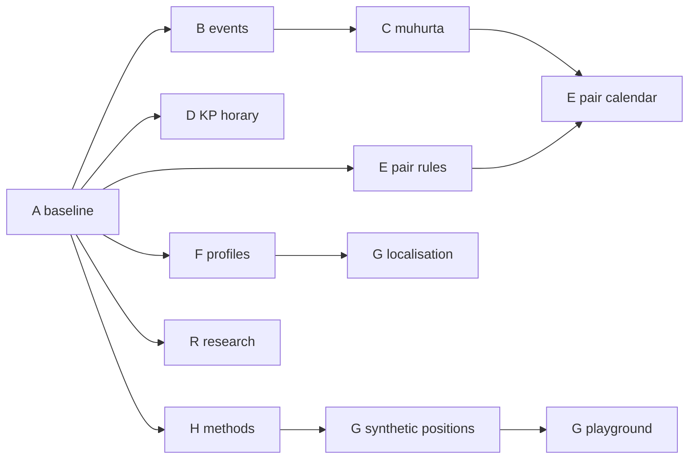

# Capability expansion

The next set of capabilities after 0.3.3: timing and events, muhūrta, KP horary, extended matching, further methods,
and the studio as a local application. Every task is in `planning/backlog.json` (milestones `expansion A` to
`expansion R`) and rendered in `TRACKING.md`; this page is the order and the rules, not a second tracker.

## Order

| Milestone | Scope | Tasks | Gate to leave it |
|---|---|---|---|
| A | Baseline and contracts | BASE-01, BASE-02, BASE-03 | Tracker matches the wheel; envelope additions and error codes documented; ṣaḍbala deltas explained per component |
| B | Events and dated bindus | EVT-01, EVT-02, EVT-03 | Independent event fixtures; bindu series explained cell by cell; equal envelopes from CLI, Python and raw JSON |
| C | Muhūrta and calendar | MUH-02, MUH-03, MUH-04 | Exact intervals; DST, half-hour zone, polar day and two event places; keyboard day detail |
| D | KP horary | KP-03 … KP-06 | All 249 entries checked; worked cusp example; natal default unchanged |
| E | Extended matching | MAT-03 … MAT-07 | 36-point output unchanged; reviewed supplementary rules; pair windows explained |
| F | Profiles and compare | APP-01 … APP-03 | Offline replay; saved zone correct; responsive panels |
| G | Localisation and playground | APP-04 … APP-07 | Reviewed first language; synthetic provenance; keyboard edits |
| H | Methods and quality | DASH-01, METH-01 … METH-03 | Each method specified and independently checked |
| R | Research models (secondary) | RES-01 … RES-04 | A written specification before any score |

Work in B, D and E can run side by side once A's contracts are settled. A studio view may be built against labelled
mock data, but nothing is marked *implemented* until the engine operation behind it passes the acceptance gate.

## Rules for this work

These restate `AGENTS.md` for the new areas; they do not replace it.

- **Engine-owned rules.** Every new deterministic rule lives in the Rust engine behind `Engine::execute_json`. The
  studio and the bindings render results; they never compute a factor of their own.
- **Unavailable is not zero.** A factor that cannot be computed (no reliable lagna, polar sunrise, a node with no BAV
  table) returns a typed unavailable state and the missing dependency.
- **Intervals are `[start, end)` in UTC.** Local strings are presentation. A search past its limit says `truncated`.
- **A method is named before it is scored.** Rankings and scores carry a profile id and version; a score whose formula
  is not written down is not built (RES-01).
- **Existing output is a compatibility boundary.** Additions are additive. A changed formula or default is a new rule
  version with golden fixtures showing the difference.
- **Every number has a reference.** An independent computation or a published worked example, stated with how it was
  checked. Station and crossing times, for instance, are checked against an offline oracle
  (`benchmarks/golden/events_oracle.json`); see `docs/reference/accuracy.md`.
- **Precision is two things.** A solver tolerance is not the ephemeris accuracy. Report both.

## Status (2026-11-23)

All 33 tasks have been worked. 29 are *verified* with evidence in `backlog.json`; 3 are *implemented*; 1 is still
*proposed*. APP-07 (guided chart creation, `eshana-report new`) was added at the owner's request and is verified.

Closed by the owner on 2026-11-23: APP-01 (ADR-013 accepted as written) and APP-04 (Hindi catalogue approved; the
interface language became a reader setting, English by default).

| Waiting on | Task | What is needed |
|---|---|---|
| Expert review (owner, later) | MUH-03 | review the muhūrta profiles; śūnya tithis by lunar month and vāra–nakṣatra yogas before purpose presets leave *experimental* |
| Expert review (owner, later) | DASH-01 | one printed chart per conditional daśā, checked to the day |
| A permission rule | BASE-03 | PyJHora as a test-only oracle is approved, but the install needs a permission rule the owner adds (see OWNER-INPUTS.md §2); or the reference program's component table |
| By design | RES-03 | the birth-time evaluator is specified; building it waits for a held-out set of births timed by record |

What each waiting item needs, in detail and as a form to fill in: [OWNER-INPUTS.md](OWNER-INPUTS.md).

Evidence for every task is in its `evidence` field. The checks that hold it: `make verify`, `make acceptance`
(122 scenarios), `make studio-journeys` (59 journeys per file, the WebAssembly parity check and 5 journeys for `eshana-report new`), and the oracles in
`benchmarks/golden/` (events, KP horary cusps, ayanāṃśas).
